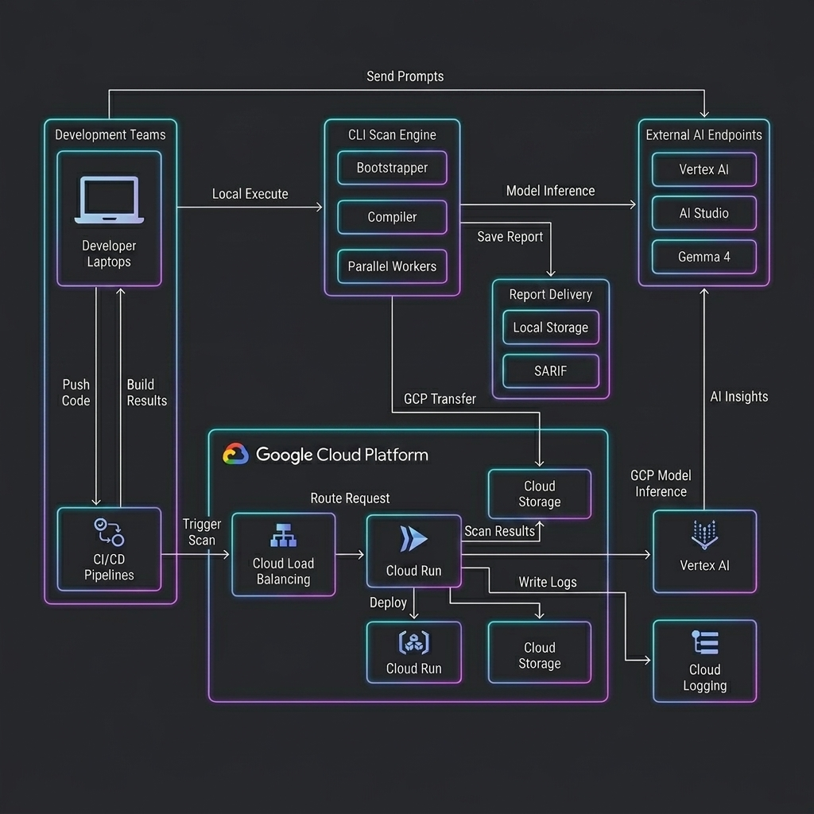
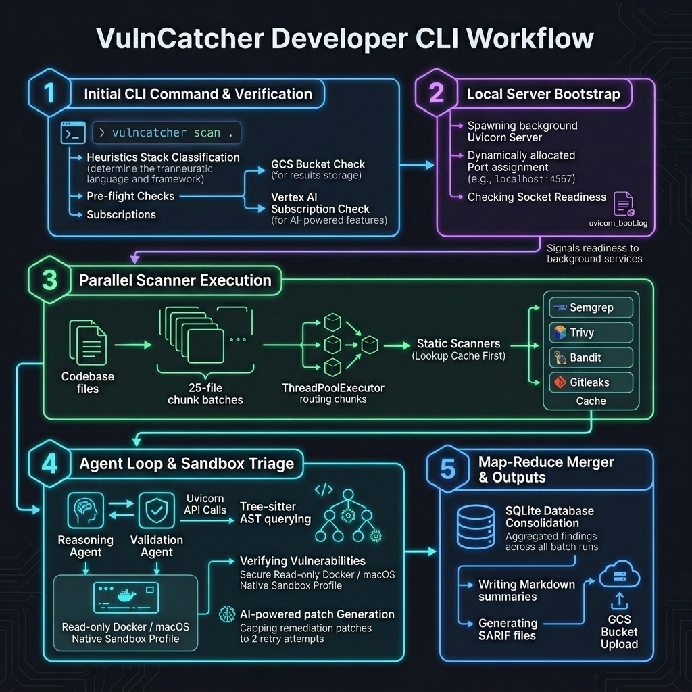

# Reference Harness — Packaging & Distribution Guide

This document covers how to package, deploy, and distribute Reference Harness to
customers and solution architects using Google Cloud Platform (GCP).

## Deployment Architecture

### GCP Deployment & Integration Architecture



### Developer CLI Workflow Architecture



## Table of Contents

- [Deployment Architecture](#deployment-architecture)
- [Current Packaging State](#current-packaging-state)
- [Prerequisites](#prerequisites)
- [Channel A: Cloud Run API Service](#channel-a-cloud-run-api-service)
- [Channel B: Python Wheel via Artifact Registry](#channel-b-python-wheel-via-artifact-registry)
- [Channel C: Terraform One-Click Deployment](#channel-c-terraform-one-click-deployment)
- [Cloud Build CI/CD Pipeline](#cloud-build-cicd-pipeline)
- [Customer-Facing Quick Reference](#customer-facing-quick-reference)
- [Action Checklist](#action-checklist)

---

## Current Packaging State

### What's Ready

| Asset                 | Status  | Notes                                                                                           |
| :-------------------- | :------ | :---------------------------------------------------------------------------------------------- |
| `pyproject.toml`      | ✅ Good | Hatchling build backend, version `1.4`, deps pinned, `[project.scripts]` entry point registered |
| `Dockerfile`          | ✅ Good | `python:3.12-slim`, `uv sync --frozen`, exposes 8080                                            |
| `app/fast_api_app.py` | ✅ Good | FastAPI/ASGI entry point, GCS artifact storage, Cloud Logging                                   |
| `uv.lock`             | ✅ Good | Lockfile for reproducible builds                                                                |
| `app/cli/main.py`     | ✅ Good | CLI entry point (`rh` command), parallel scanning, GCS uploads                                  |

### Gaps to Address Before Distribution

All gaps have been successfully resolved and implemented in the repository:

| Gap                                     | Status          | Solution                                                                              | Priority |
| :-------------------------------------- | :-------------- | :------------------------------------------------------------------------------------ | :------- |
| `[project.scripts]` console entry point | ✅ **Resolved** | `rh = "app.cli.main:entry_point"` registered in `pyproject.toml`                      | ✅ Done  |
| `scan.py` not in wheel package          | ✅ **Resolved** | Refactored CLI logic into `app/cli/` module files, included in Python wheel           | ✅ Done  |
| No Cloud Build / CI/CD config           | ✅ **Resolved** | Added production-ready `cloudbuild.yaml` at the project root                          | ✅ Done  |
| No Terraform / IaC for GCP infra        | ✅ **Resolved** | Created full `deploy/` Terraform IaC module (`main.tf`, `variables.tf`, `outputs.tf`) | ✅ Done  |
| Dockerfile missing SAST tools           | ✅ **Resolved** | Enhanced `Dockerfile` to install Semgrep, Trivy, Gitleaks, and Bandit                 | ✅ Done  |
| No health check endpoint                | ✅ **Resolved** | Added GET `/health` in `app/fast_api_app.py` and updated container readiness probes   | ✅ Done  |
| Description empty in `pyproject.toml`   | ✅ **Resolved** | Standard description populated in hatchling configs                                   | ✅ Done  |

### Fix 1: CLI Entry Point (Already Implemented)

The `[project.scripts]` entry point is already registered in `pyproject.toml`:

```toml
[project.scripts]
rh = "app.cli.main:entry_point"
```

After installation (`uv tool install rh` or `pip install rh`), the `rh` command
is available system-wide.

### Fix 2: Enhance Dockerfile with SAST Tool Installs

See [Channel A: Dockerfile](#step-1-enhance-the-dockerfile) below for the
production-ready Dockerfile.

---

## Prerequisites

```bash
# Set common environment variables used throughout this guide
export PROJECT_ID="<YOUR_PROJECT_ID>"
export REGION="us-central1"
export REPO_NAME="rh"
export SA_EMAIL="reference-harness-runner@${PROJECT_ID}.iam.gserviceaccount.com"
```

Required GCP APIs:

```bash
gcloud services enable \
    artifactregistry.googleapis.com \
    run.googleapis.com \
    cloudbuild.googleapis.com \
    aiplatform.googleapis.com \
    logging.googleapis.com \
    storage.googleapis.com \
    --project=${PROJECT_ID}
```

---

## Channel A: Cloud Run API Service

> **Best for:** Automated CI/CD pipelines (GitHub Actions, GitLab CI, Cloud
> Build triggers) and internal team portals.

### Step 1: Enhance the Dockerfile

The current Dockerfile is minimal. For production distribution it needs the SAST
scanner binaries:

```dockerfile
FROM python:3.12-slim

# Install system dependencies and SAST scanners
RUN apt-get update && apt-get install -y --no-install-recommends \
    git curl && \
    rm -rf /var/lib/apt/lists/*

# Install uv
RUN pip install --no-cache-dir uv==0.8.13

# Install Semgrep
RUN pip install --no-cache-dir semgrep

# Install Gitleaks
ARG GITLEAKS_VERSION=8.18.2
RUN curl -sSLo /tmp/gitleaks.tar.gz \
    "https://github.com/gitleaks/gitleaks/releases/download/v${GITLEAKS_VERSION}/gitleaks_${GITLEAKS_VERSION}_linux_amd64.tar.gz" && \
    tar -xzf /tmp/gitleaks.tar.gz -C /usr/local/bin gitleaks && \
    rm /tmp/gitleaks.tar.gz

# Install Trivy
RUN curl -sfL https://raw.githubusercontent.com/aquasecurity/trivy/main/contrib/install.sh \
    | sh -s -- -b /usr/local/bin

# Install Bandit
RUN pip install --no-cache-dir bandit

WORKDIR /code
COPY ./pyproject.toml ./README.md ./uv.lock* ./
COPY ./app ./app
COPY ./scan.py ./scan.py

RUN uv sync --frozen

ARG COMMIT_SHA=""
ENV COMMIT_SHA=${COMMIT_SHA}
ARG AGENT_VERSION=0.0.0
ENV AGENT_VERSION=${AGENT_VERSION}

EXPOSE 8080

# Health check for Cloud Run
HEALTHCHECK --interval=30s --timeout=5s --start-period=10s \
    CMD curl -f http://localhost:8080/docs || exit 1

CMD ["uv", "run", "uvicorn", "app.fast_api_app:app", "--host", "0.0.0.0", "--port", "8080"]
```

### Step 2: Create Artifact Registry Docker Repository

```bash
gcloud artifacts repositories create ${REPO_NAME} \
    --repository-format=docker \
    --location=${REGION} \
    --project=${PROJECT_ID} \
    --description="Reference Harness container images"

# Configure Docker auth
gcloud auth configure-docker ${REGION}-docker.pkg.dev
```

### Step 3: Build & Push the Container Image

```bash
docker build \
    --build-arg COMMIT_SHA=$(git rev-parse HEAD) \
    --build-arg AGENT_VERSION=$(grep 'version' pyproject.toml | head -1 | cut -d'"' -f2) \
    -t ${REGION}-docker.pkg.dev/${PROJECT_ID}/${REPO_NAME}/rh:latest \
    -t ${REGION}-docker.pkg.dev/${PROJECT_ID}/${REPO_NAME}/rh:$(git rev-parse --short HEAD) \
    .

docker push ${REGION}-docker.pkg.dev/${PROJECT_ID}/${REPO_NAME}/rh --all-tags
```

### Step 4: Create Service Account & Grant IAM Roles

```bash
# Create a dedicated service account
gcloud iam service-accounts create reference-harness-runner \
    --display-name="Reference Harness Runtime SA" \
    --project=${PROJECT_ID}

# Vertex AI access (for Gemini model calls)
gcloud projects add-iam-policy-binding ${PROJECT_ID} \
    --member="serviceAccount:${SA_EMAIL}" \
    --role="roles/aiplatform.user"

# Storage access (for report uploads)
gcloud projects add-iam-policy-binding ${PROJECT_ID} \
    --member="serviceAccount:${SA_EMAIL}" \
    --role="roles/storage.objectAdmin" \
    --condition="expression=resource.name.startsWith('projects/_/buckets/reference-harness-reports'),title=reports-bucket-only"
```

### Step 5: Deploy to Cloud Run

```bash
gcloud run deploy rh \
    --image=${REGION}-docker.pkg.dev/${PROJECT_ID}/${REPO_NAME}/rh:latest \
    --service-account=${SA_EMAIL} \
    --region=${REGION} \
    --project=${PROJECT_ID} \
    --memory=4Gi \
    --cpu=2 \
    --timeout=3600 \
    --concurrency=1 \
    --min-instances=0 \
    --max-instances=5 \
    --set-env-vars="GOOGLE_CLOUD_PROJECT=${PROJECT_ID},LOGS_BUCKET_NAME=reference-harness-reports-${PROJECT_ID}" \
    --no-allow-unauthenticated
```

> **Important:** `--timeout=3600` and `--concurrency=1` are critical. Reference
> Harness scans are long-running and stateful (per-session ADK state). Each
> instance should handle only one scan at a time.

### Step 6: Grant Customer Access via IAM

```bash
# For a customer's service account (Workload Identity Federation)
gcloud run services add-iam-policy-binding rh \
    --region=${REGION} \
    --member="serviceAccount:customer-sa@customer-project.iam.gserviceaccount.com" \
    --role="roles/run.invoker"

# For a specific user
gcloud run services add-iam-policy-binding rh \
    --region=${REGION} \
    --member="user:customer@example.com" \
    --role="roles/run.invoker"
```

---

## Channel B: Python Wheel via Artifact Registry

> **Best for:** Solution architects doing hands-on demos, developers running
> pre-commit scans locally.

### Step 1: Create Artifact Registry Python Repository

```bash
gcloud artifacts repositories create reference-harness-python \
    --repository-format=python \
    --location=${REGION} \
    --project=${PROJECT_ID} \
    --description="Reference Harness Python packages"
```

### Step 2: Build the Wheel

```bash
uv build
```

This produces `dist/rh-1.4-py3-none-any.whl` and `dist/rh-1.4.tar.gz`.

### Step 3: Upload to Artifact Registry

```bash
pip install twine keyring keyrings.google-artifactregistry-auth

python -m twine upload \
    --repository-url https://${REGION}-python.pkg.dev/${PROJECT_ID}/reference-harness-python/ \
    dist/*
```

### Step 4: Customer Installation

Customers install with a single command:

```bash
# Using uv (recommended)
uv tool install \
    --extra-index-url https://${REGION}-python.pkg.dev/${PROJECT_ID}/reference-harness-python/simple/ \
    rh

# Or with pip
pip install \
    --extra-index-url https://${REGION}-python.pkg.dev/${PROJECT_ID}/reference-harness-python/simple/ \
    rh
```

Then scan:

```bash
# With Google AI Studio key
export GEMINI_API_KEY="AIzaSy..."
rh /path/to/target

# Or with GCP Vertex AI (enterprise)
gcloud auth application-default login
rh /path/to/target --pro-model gemini-2.5-pro --flash-model gemini-2.5-flash

# Parallel scan with GCS upload
rh /path/to/target --parallel 4 --gcs-bucket my-reports --output-format both
```

> **Note:** Customers still need the SAST tools (Semgrep, Gitleaks, Trivy,
> Bandit) installed on their local machines. See the main
> [README.md](./README.md) setup section for install instructions.

---

## Channel C: Terraform One-Click Deployment

> **Best for:** Solution architects deploying Reference Harness into a
> customer's own GCP project.

Create a `deploy/` directory at the project root with the following structure:

```text
deploy/
├── main.tf
├── variables.tf
├── outputs.tf
└── README.md
```

### `deploy/variables.tf`

```hcl
variable "project_id" {
  description = "GCP project ID to deploy into"
  type        = string
}

variable "region" {
  description = "GCP region for deployment"
  type        = string
  default     = "us-central1"
}

variable "image_tag" {
  description = "Container image tag to deploy"
  type        = string
  default     = "latest"
}

variable "source_image_project" {
  description = "Project ID hosting the Reference Harness container image"
  type        = string

}

variable "source_repo" {
  description = "Artifact Registry repo name in the source project"
  type        = string
  default     = "rh"
}
```

### `deploy/main.tf`

```hcl
provider "google" {
  project = var.project_id
  region  = var.region
}

# Service Account
resource "google_service_account" "rh" {
  account_id   = "reference-harness-runner"
  display_name = "Reference Harness Runtime"
}

# Reports Bucket
resource "google_storage_bucket" "reports" {
  name                        = "${var.project_id}-reference-harness-reports"
  location                    = var.region
  uniform_bucket_level_access = true
  force_destroy               = false
}

# IAM: Vertex AI
resource "google_project_iam_member" "vertex_ai" {
  project = var.project_id
  role    = "roles/aiplatform.user"
  member  = "serviceAccount:${google_service_account.rh.email}"
}

# IAM: Cloud Storage
resource "google_project_iam_member" "storage" {
  project = var.project_id
  role    = "roles/storage.objectAdmin"
  member  = "serviceAccount:${google_service_account.rh.email}"
}

# IAM: Cloud Logging
resource "google_project_iam_member" "logging" {
  project = var.project_id
  role    = "roles/logging.logWriter"
  member  = "serviceAccount:${google_service_account.rh.email}"
}

# Cloud Run Service
resource "google_cloud_run_v2_service" "rh" {
  name     = "rh"
  location = var.region

  template {
    service_account = google_service_account.rh.email

    containers {
      image = "${var.region}-docker.pkg.dev/${var.source_image_project}/${var.source_repo}/rh:${var.image_tag}"

      resources {
        limits = {
          cpu    = "2"
          memory = "4Gi"
        }
      }

      env {
        name  = "GOOGLE_CLOUD_PROJECT"
        value = var.project_id
      }
      env {
        name  = "LOGS_BUCKET_NAME"
        value = google_storage_bucket.reports.name
      }
    }

    timeout                          = "3600s"
    max_instance_request_concurrency = 1

    scaling {
      min_instance_count = 0
      max_instance_count = 5
    }
  }
}
```

### `deploy/outputs.tf`

```hcl
output "service_url" {
  description = "Reference Harness Cloud Run service URL"
  value       = google_cloud_run_v2_service.rh.uri
}

output "service_account" {
  description = "Runtime service account email"
  value       = google_service_account.rh.email
}

output "reports_bucket" {
  description = "GCS bucket for vulnerability reports"
  value       = google_storage_bucket.reports.name
}
```

### Usage

```bash
cd deploy/
terraform init
terraform apply \
    -var="project_id=customer-gcp-project" \
    -var="region=us-central1" \
    -var="image_tag=latest"
```

---

## Cloud Build CI/CD Pipeline

Create `cloudbuild.yaml` at the project root for automated build-and-deploy on
every push:

```yaml
steps:
  # Run unit tests
  - name: "python:3.12-slim"
    entrypoint: bash
    args:
      - -c
      - |
        pip install uv
        uv sync --frozen
        uv run pytest tests/unit -v

  # Build container image
  - name: "gcr.io/cloud-builders/docker"
    args:
      - "build"
      - "--build-arg=COMMIT_SHA=$COMMIT_SHA"
      - "--build-arg=AGENT_VERSION=$TAG_NAME"
      - "-t"
      - "${_REGION}-docker.pkg.dev/$PROJECT_ID/${_REPO}/rh:$COMMIT_SHA"
      - "-t"
      - "${_REGION}-docker.pkg.dev/$PROJECT_ID/${_REPO}/rh:latest"
      - "."

  # Push to Artifact Registry
  - name: "gcr.io/cloud-builders/docker"
    args:
      - "push"
      - "--all-tags"
      - "${_REGION}-docker.pkg.dev/$PROJECT_ID/${_REPO}/rh"

  # Deploy to Cloud Run
  - name: "gcr.io/google.com/cloudsdktool/cloud-sdk"
    args:
      - "gcloud"
      - "run"
      - "deploy"
      - "rh"
      - "--image=${_REGION}-docker.pkg.dev/$PROJECT_ID/${_REPO}/rh:$COMMIT_SHA"
      - "--region=${_REGION}"
      - "--project=$PROJECT_ID"

substitutions:
  _REGION: us-central1
  _REPO: rh

images:
  - "${_REGION}-docker.pkg.dev/$PROJECT_ID/${_REPO}/rh"
```

### Set Up the Cloud Build Trigger

```bash
# Connect your GitHub repo (interactive, one-time)
gcloud builds triggers create github \
    --repo-name=global-solutions-reference-harness \
    --repo-owner=cloud-gtm \
    --branch-pattern="^main$" \
    --build-config=cloudbuild.yaml \
    --project=${PROJECT_ID}
```

---

## Customer-Facing Quick Reference

### Solution Architects — Local CLI

```bash
uv tool install \
    --extra-index-url https://us-central1-python.pkg.dev/tarunsharma-default-58b99/reference-harness-python/simple/ \
    rh

export GEMINI_API_KEY="..."
rh /path/to/customer-code
```

### CI/CD Pipelines — Cloud Run API

```bash
TOKEN=$(gcloud auth print-identity-token)
curl -X POST https://rh-XXXX.run.app/run_sse \
    -H "Authorization: Bearer ${TOKEN}" \
    -H "Content-Type: application/json" \
    -d '{
        "app_name": "app",
        "user_id": "ci-user",
        "session_id": "scan-1",
        "new_message": {
            "role": "user",
            "parts": [{"text": "Scan /workspace for vulnerabilities and write a report."}]
        }
    }'
```

### Solution Architects — Terraform Deployment

```bash
cd deploy/
terraform init
terraform apply -var="project_id=customer-gcp-project"
```

---

## IAM & Authentication Policy

| Role                        | Purpose                                | Assigned To             |
| :-------------------------- | :------------------------------------- | :---------------------- |
| `roles/aiplatform.user`     | Invoke Gemini models via Vertex AI     | Runtime service account |
| `roles/storage.objectAdmin` | Upload reports to GCS bucket           | Runtime service account |
| `roles/logging.logWriter`   | Write structured logs to Cloud Logging | Runtime service account |
| `roles/run.invoker`         | Call the Cloud Run endpoint            | Customer SA or user     |

### Workload Identity Federation (for external CI/CD)

External pipelines (GitHub Actions, GitLab CI) should use Workload Identity
Federation instead of long-lived service account keys:

```bash
# Create a Workload Identity Pool (one-time)
gcloud iam workload-identity-pools create github-pool \
    --location="global" \
    --project=${PROJECT_ID}

# Create a provider for GitHub
gcloud iam workload-identity-pools providers create-oidc github-provider \
    --location="global" \
    --workload-identity-pool="github-pool" \
    --issuer-uri="https://token.actions.githubusercontent.com" \
    --attribute-mapping="google.subject=assertion.sub,attribute.repository=assertion.repository" \
    --project=${PROJECT_ID}

# Grant the federated identity permission to invoke Cloud Run
gcloud run services add-iam-policy-binding rh \
    --region=${REGION} \
    --member="principalSet://iam.googleapis.com/projects/PROJECT_NUMBER/locations/global/workloadIdentityPools/github-pool/attribute.repository/cloud-gtm/customer-repo" \
    --role="roles/run.invoker"
```

---

## Action Checklist

| #   | Action                                                                   | Status   | Impact                                         |
| :-- | :----------------------------------------------------------------------- | :------- | :--------------------------------------------- |
| 1   | Add `[project.scripts]` entry point & move `scan.py` → `app/cli/main.py` | ✅ Done  | `rh` CLI command works after install           |
| 2   | Enhance Dockerfile with SAST tool installs + health check                | ✅ Done  | Container works standalone with dynamic probes |
| 3   | Add `cloudbuild.yaml` for automated build-deploy                         | ✅ Done  | Automated CI/CD push-to-deploy pipeline        |
| 4   | Create `deploy/` Terraform module                                        | ✅ Done  | One-click customer deployment IaC module       |
| 5   | Build & publish wheel to Artifact Registry                               | 🟡 Ready | Run `hatch build` or `uv build` to distribute  |
| 6   | Fill in `pyproject.toml` description + add classifiers                   | ✅ Done  | Professional package metadata                  |

> **Recommended next step:** Run local package builds using `hatch build` or
> `uv build` to publish the release wheel.
