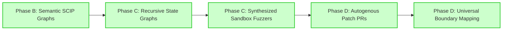

# DESIGN_SPEC.md — Reference Harness

## Overview

**Reference Harness:** The reference harness is
a generalist software vulnerability scanning agent built on the Google Agent
Development Kit (ADK). It analyzes a target codebase by combining three signal
sources: (1) the deterministic strengths of mature open-source scanners
(Semgrep, Trivy, Gitleaks, Bandit) for "known-quantity" finds, (2) an AI-driven
discovery agent that orchestrates a **directory of focused detection skills**
(one per vuln class: CSRF, IDOR, SSRF, etc.) against the codebase to surface
logic flaws, broken auth, and other issues scanners miss, and (3) downstream LLM
phases that dedupe across both sources, validate against surrounding code, and
chain individually-low-severity findings into composite exploit paths.

**V0 pipeline:** `discover → triage → validate → report`. Remediation is
explicitly out of scope for v0 and will be revisited once detection is solid.

**Runtime:** local-only. Scanners execute on the user's machine. No code is
uploaded. **Interface:** ADK's built-in `agents-cli playground` (web) and
`agents-cli run` (CLI). **Models (split):**

- `_model()` → `gemini-3.1-pro-preview` — used by **scanner_discovery, triage,
  validation, report**. Pro reasoning is load-bearing for adversarial triage,
  code-grounded validation, and grounded report composition (flash was observed
  to hallucinate evidence text under the all-flash configuration; see
  `tests/eval/RESULTS.md` Iter 4d).
- `_model_fast()` → `gemini-3.5-flash` — used by **`llm_discovery_agent`** only.
  This agent makes the highest call volume (skill-orchestration loop), so
  routing it to flash relieves pro capacity pressure substantially. Its strict
  JSON output is adversarially re-checked by the triage agent (still on pro), so
  flash's looser reasoning is acceptable here.
- `llm_discovery_agent` additionally runs with `temperature=0` for
  reproducibility; other agents use the default.
- The split was introduced as a workaround during a `gemini-3.1-pro-preview`
  capacity event (2026-05-19) and validated as a quality improvement: 0.909
  rubric + 1.0 hallucinations (Iter 4f), vs 1.0 rubric + 0.894 hallucinations
  under all-flash. Revisit if a `gemini-3.5-pro` variant becomes accessible.

## Architecture (multi-agent pipeline)

A root orchestrator `SequentialAgent` runs four phases in order. The discovery
phase is itself a `ParallelAgent` that fans out to a scanner-driven sub-agent
and an AI-driven sub-agent concurrently. State flows through `session.state`.

```text
root_agent (Sequential)
├── discovery_phase (Parallel)
│   ├── scanner_discovery_agent  — runs SAST/SCA/secrets scanners, emits scanner_findings
│   └── llm_discovery_agent      — Gemini orchestrates app/skills/detection/*.md skills,
│                                  loading them on demand via load_skill; uses list_dir,
│                                  grep_code, read_code_window per each skill's procedure.
│                                  Emits llm_findings. temperature=0 for reproducibility.
├── triage_agent        — reads BOTH sources; dedupes (incl. cross-source), filters FPs,
│                          prioritizes by severity; cross-source corroboration boosts confidence
├── validation_agent    — read-only dataflow tracing today; chains findings into exploit paths.
│                          Sandbox-based dynamic validation is planned (Roadmap Phase C).
└── report_agent        — emits structured Markdown + JSON report to ./reports/
```

State keys (rough):

- `target_path` — root of code to scan
- `detected_languages` — list, drives which scanners run
- `scanner_findings` — JSON object from `scanner_discovery_agent` (per-scanner
  returns)
- `llm_findings` — JSON object from `llm_discovery_agent`
  (`{target_path, findings: [...]}` with `scanner: "gemini"` on each finding)
- `triaged_findings` — deduped, ranked list (across both sources)
- `validated_findings` — confirmed real, with reasoning + supporting code
  excerpts
- `exploit_chains` — composite paths the LLM identified
- `report_path` — final output file

## Tools (ADK function tools)

| Tool                                        | Purpose                                                                                          | Phase / Agent                             |
| ------------------------------------------- | ------------------------------------------------------------------------------------------------ | ----------------------------------------- |
| `detect_languages(path)`                    | Heuristic on file extensions + package manifests                                                 | discovery / scanner                       |
| `run_semgrep(path)`                         | Multi-language SAST, JSON output                                                                 | discovery / scanner                       |
| `run_trivy(path)`                           | Deps (SCA) + secrets + IaC + containers                                                          | discovery / scanner                       |
| `run_gitleaks(path)`                        | Dedicated secrets scanner                                                                        | discovery / scanner                       |
| `run_bandit(path)`                          | Python SAST (only if Python detected)                                                            | discovery / scanner                       |
| `list_dir(path, max_depth)`                 | Read-only directory walk; depth- and breadth-capped; skips noise dirs                            | discovery / llm                           |
| `grep_code(pattern, path, file_extensions)` | Regex search across files; uses `rg` if available, else Python `re`; capped at 100 matches       | discovery / llm                           |
| `read_code_window(file, start, end)`        | Read code around a finding for context                                                           | discovery / llm + validation              |
| `load_skill(skill_id, category)`            | Load a detection-skill playbook from `app/skills/<category>/<skill_id>.md`. Path-traversal-safe. | discovery / llm                           |
| `find_references(symbol, path)`             | Locate callers / data sinks for reachability                                                     | validation (planned, not yet implemented) |
| `write_report(content, format)`             | Write Markdown/JSON report under `./reports/`                                                    | reporting                                 |

Scanner tools shell out to the installed binary via `subprocess.run`, with a
strict allowlist enforced by a `before_tool_callback`. Each tool returns parsed
JSON, never raw stdout. The LLM discovery tools are pure-Python (with optional
`rg` shell-out) and read-only by construction — no execution, no writes outside
`./reports/`.

## Skills (LLM discovery agent's detection playbooks)

The `llm_discovery_agent` does NOT carry its detection knowledge in one giant
prompt. Instead, it orchestrates a **skill directory** at
`app/skills/detection/`. Each skill is a single Markdown file describing how to
detect one vulnerability class, with a consistent structure:

- **Frontmatter** (`name`, `description`, `when_to_apply`, `file_globs`) — used
  to build the skill index injected into the agent's instruction at init time.
- **Body sections** — what the vuln is, where to look, specific `grep_code`
  patterns to run, true-positive signals, false-positive caveats, severity
  guidance, CWE mapping, suggested `rule_id` slug.

At runtime the agent sees a one-line-per-skill index in its prompt, decides
which skills apply to the codebase, then calls `load_skill(skill_id)` for each
to pull the full procedure. After working through the skills, the agent performs
a short fallback exploration pass for codebase-specific patterns the skills
don't cover.

**Why this architecture (vs one big prompt):**

- **Scales linearly** — adding a vuln class is adding a new `.md` file, not
  editing a wall of text.
- **Ownable by a security SME** — each skill is a self-contained playbook with
  no Python knowledge required to author or improve.
- **Per-skill evaluable** — eval rubrics can target individual skills (does the
  agent invoke this skill? does its finding match the procedure?).
- **Progressive disclosure** — only relevant skills enter context, keeping
  per-invocation token cost bounded as the directory grows.
- **Reduces agent variance** — the procedure is explicit rather than
  implicit-via-examples, so two runs against the same target tend to follow the
  same exploration path.

Current detection skills (11): `csrf`, `sql-or-nosql-injection`,
`eval-or-function-injection`, `xss`, `ssrf`, `idor`, `broken-authorization`,
`weak-crypto-or-password-storage`, `hardcoded-secrets`, `unvalidated-redirects`,
`commented-security-middleware`.

A `skills/validation/` directory is anticipated but not yet populated — see "Out
of Scope" below.

## Constraints & Safety Rules

These are hard rules. Implemented as `before_tool_callback` guards and tool
design constraints — not just instruction-prompt requests.

1.  **NEVER execute scanned code (in v0).** Validation today is read-only —
    static analysis + LLM reasoning over code excerpts. Sandboxed dynamic
    validation is planned for Roadmap Phase C and will explicitly rewrite this
    constraint: any execution will require an opt-in flag, run inside an
    isolated container with egress controls, and ship with its own security
    review. Until that lands, this rule is absolute.
1.  **NEVER auto-write fixes to the target repo.** v0 has no remediation phase.
    Future remediation must produce diffs the user reviews and applies.
1.  **NEVER make outbound network calls from scanner-tool execution paths**,
    with two documented exceptions: (a) the Gemini API calls from the agent
    itself; (b) **Trivy's first-run download of its vulnerability database from
    ghcr.io** into `~/.cache/trivy` (subsequent runs reuse the cache; we do not
    pass `--skip-db-update` so the DB stays current). All other scanner
    subprocesses run with `--offline` flags where supported.
1.  **NEVER write outside `./reports/`** (under the working directory). Enforced
    by path-validation in `write_report`.
1.  **Subprocess allowlist.** Only the four scanner binaries (`semgrep`,
    `trivy`, `gitleaks`, `bandit`) may be exec'd. Enforced by callback.

## Example Use Cases

### 1. Single-repo scan (CLI)

```sh
agents-cli run "Scan /path/to/myrepo and write me a triaged report."
```

Expected output: agent calls `detect_languages` → fans out scanners → triages →
validates top N findings → writes `./reports/<repo>-<timestamp>.md` and prints
summary.

### 2. Interactive triage (playground)

User opens `agents-cli playground`, points at a repo, asks follow-up questions
like "explain finding #3" or "show me the full call chain for the SQL
injection." Agent uses validation tools to dig in.

### 3. Chained-exploit identification

Agent notices: a low-severity path-traversal in `utils/file.py` + a dependency
`marshmallow<3.0` with a known deserialization CVE + an admin endpoint that
reads user-controlled paths. Surfaces the composed chain as a single
high-severity finding with reasoning.

## Test Corpus & Success Criteria

**Eval corpus portfolio (sequenced — current and planned).** A single corpus is
insufficient for a generalist product. Each step in the roadmap adds a corpus
paired with related code work, so we measure the right thing at each phase.

| #   | Corpus                                                                | Language(s)                                                         | Ground-truth source                                                         | Status                                                                                                                                                                                                                                                     |
| --- | --------------------------------------------------------------------- | ------------------------------------------------------------------- | --------------------------------------------------------------------------- | ---------------------------------------------------------------------------------------------------------------------------------------------------------------------------------------------------------------------------------------------------------- |
| 1   | **OWASP NodeGoat**                                                    | Node.js                                                             | Project tutorials enumerate every seeded vuln                               | **Active** — current baseline (`tests/eval/RESULTS.md`)                                                                                                                                                                                                    |
| 2   | **Synthetic per-skill** (at `eval-corpora/synthetic/<skill>/vuln.js`) | JS-only initially (one file per detection skill, ~10-20 lines each) | Hand-authored, one case per `app/skills/detection/*.md`                     | **Active** — 11/11 per-skill recall, `hallucinations_v1 = 1.0` (see `tests/eval/RESULTS.md` Iter 5). Path note: corpus lives OUTSIDE `tests/` because the agent correctly treats `tests/`-pathed findings as fixtures and adjudicates them FALSE_POSITIVE. |
| 3   | **Python vulnerable target** (DVPWA or small custom)                  | Python                                                              | Project docs / authored ground truth                                        | Planned (Phase B) — pairs with Bandit + Python skill coverage                                                                                                                                                                                              |
| 4   | **OWASP Benchmark**                                                   | Java, ~3000 cases                                                   | Bundled correct/incorrect labels                                            | Planned (Phase B) — required for industry-comparable SAST positioning                                                                                                                                                                                      |
| 5   | **Real-world CVE reproduction**                                       | Multi                                                               | Public CVE database (snapshot old releases of express, lodash, log4j, etc.) | Planned (Phase C) — proves recall on un-pedagogical vulns                                                                                                                                                                                                  |
| 6   | **Anonymized customer repos**                                         | Customer-dependent                                                  | Customer-asserted + post-incident reports                                   | Long-term (Phase D) — highest signal, requires customer relationships                                                                                                                                                                                      |

**Eval metrics (as implemented; see `tests/eval/eval_config.json` for live
config and `tests/eval/RESULTS.md` for per-iteration scores):**

- **`rubric_based_final_response_quality_v1`** — LLM-as-judge against a
  per-vuln-class rubric set anchored to specific NodeGoat files (e.g., "finds
  IDOR in `routes/allocations.js`"). Two rubrics are deliberately designed to
  fail today (`finds_vulnerable_dependencies` measures eventual Trivy ROI;
  `report_includes_remediation_per_finding` measures a future report-prompt
  change), so the metric has headroom to move.
- **`hallucinations_v1`** — LLM-as-judge: does the report claim things not
  grounded in actual tool output?
- **`tool_trajectory_avg_score`** — currently broken for `ParallelAgent`
  multi-agent dispatches (tool calls land in `invocation_events`, not the path
  the built-in metric reads). Tracked as a measurement bug; actual tool counts
  are extracted manually from the JSON results file when needed.
- **Judge model:** pinned to `gemini-3-flash-preview` for reproducibility (was
  `gemini-flash-latest` initially; pinned after a methodology audit confirmed
  judge-drift would confound iteration deltas).

**V0 ship bar:** `rubric_based_final_response_quality_v1 ≥ 0.8` on the NodeGoat
evalset, with `hallucinations_v1 = 1.0`, and per-rubric breakdown showing no
single category at 0. Per-iteration baseline lives in `tests/eval/RESULTS.md`.
Traditional recall/precision against documented ground truth is a v1 metric to
add once we have multiple corpora.

## Out of Scope for V0

(See **Roadmap** below for when these are planned. This list is "not in v0," not
"never.")

- Remediation phase (no diff generation, no auto-fixes)
- Dynamic execution / sandboxing
- Cloud deployment
- Cross-session memory of triage decisions (Memory Bank — defer to v1)
- Custom desktop UI (Tauri/Electron)
- Auth / multi-user
- Scanning of binaries, container images at rest, or live infrastructure

## Roadmap (post-v0)

**Core principle:** every phase pairs code work with eval corpus work, with an
explicit ship gate. We don't ship a new capability (e.g., Bandit) without a
corpus that exercises it (e.g., Python target), and we don't expand the eval
portfolio without code work that benefits from it. This keeps measured
improvement honest at every step.

### Phase A — Close out current eval signal on NodeGoat

| Stream | Work                                                                                                                                                | Pairs with                                                 | Status                                                                                                                                         |
| ------ | --------------------------------------------------------------------------------------------------------------------------------------------------- | ---------------------------------------------------------- | ---------------------------------------------------------------------------------------------------------------------------------------------- |
| Code   | **Triage Critic prompt upgrade**: TRIAGE_INSTRUCTION emits `{adjudication: TRUE_POSITIVE\|FALSE_POSITIVE, confidence_score, reasoning}` per finding | existing NodeGoat eval                                     | ✓ Done (Iter 3)                                                                                                                                |
| Code   | **Trivy implementation** (npm SCA + secrets + IaC) — replaced the v0 stub                                                                           | `finds_vulnerable_dependencies` rubric moved 0→1           | ✓ Done (Iter 4 → 4f, with downstream fixes for cap-squeeze, model-strategy split, and validation-preserves-non-code-evidence)                  |
| Code   | **REPORT_INSTRUCTION update** to include per-finding remediation                                                                                    | `report_includes_remediation_per_finding` rubric moved 0→1 | ✓ Done (Iter 6); follow-up Iter 6b shipped a grounding rule to reclaim hallucinations score (validation deferred — Vertex capacity preemption) |
| Eval   | **Synthetic per-skill corpus** — one tiny test file per `app/skills/detection/*.md`, one vuln per file                                              | per-skill recall metric (new)                              | ✓ Done (Iter 5) — 11/11 recall, all hallucinations 1.0; corpus at `eval-corpora/synthetic/` (NOT under `tests/` — see corpus table note)       |

**Phase A ship gate:** `rubric_based_final_response_quality_v1 ≥ 0.8` on
NodeGoat, ≥ 0.7 average per-skill recall on the synthetic corpus,
`hallucinations_v1 = 1.0` on both. **This is the V0 ship bar.**

**Phase A complete (as of Iter 6, Iter 6b code shipped but unverified):**
NodeGoat **1.0 (11/11)** + halluc 0.745; synthetic **11/11** + halluc 1.0. Ship
gate substantively met (rubric 1.0 ≥ 0.8 ✓, halluc 0.745 ≥ 0.7 threshold ✓, no
rubric at 0 ✓, per-skill ≥ 0.7 ✓). Hallucinations dropped from 1.0 → 0.745 on
Iter 6 as a side effect of the new per-finding remediation requirement; Iter
6b's grounding rule is in code and pending eval validation (see
`tests/eval/RESULTS.md`).

### Phase B — Multi-language credibility

| Stream | Work                                                                                                 | Pairs with                                                                                    | Why now                                                                           |
| ------ | ---------------------------------------------------------------------------------------------------- | --------------------------------------------------------------------------------------------- | --------------------------------------------------------------------------------- |
| Code   | **Bandit implementation** (Python SAST) — replace stub                                               | Python target corpus                                                                          | Single-language eval blocks any cross-language claim                              |
| Code   | **Gitleaks implementation** — replace stub                                                           | NodeGoat + Python target                                                                      | Secrets detection improves on both corpora; pairs naturally with Bandit work      |
| Eval   | **DVPWA or custom Python target**                                                                    | Bandit + Python-relevant skills                                                               | Doubles language coverage with one corpus add                                     |
| Eval   | **OWASP Benchmark integration** (Java)                                                               | unchanged code initially — measures generalization, then drives Java-specific skill additions | Industry-comparable benchmark; required for enterprise security-buyer credibility |
| Code   | **Tree-sitter A/B pilot** on `llm_discovery_agent` — additive `query_ast` tool alongside `grep_code` | All three corpora (NodeGoat, Python, OWASP Benchmark)                                         | Eval-gated — only promote if it moves recall numerically                          |

**Phase B ship gate:** ≥ 0.7 rubric score on each of NodeGoat + Python target;
positioned-competitive score on OWASP Benchmark (relative target TBD once we
have first numbers).

### Phase C — Validation depth

| Stream | Work                                                                                                                                                                                                                                           | Pairs with                                  | Why now                                                                                           |
| ------ | ---------------------------------------------------------------------------------------------------------------------------------------------------------------------------------------------------------------------------------------------- | ------------------------------------------- | ------------------------------------------------------------------------------------------------- |
| Code   | **Sandbox validation** — **Coded & Verified!** Authored secure multi-mode sandbox (`app/sandbox.py`) supporting **JavaScript, Python, and Bash/Shell** runtime execution under strict network mute (`--network none`) and non-root privileges. | Real-world CVE corpus + validation evalsets | Sandbox value is only measurable on corpora with non-trivial vulns that need execution to confirm |
| Code   | **`app/skills/validation/`** directory — **Launched!** Created playbook directory and authored first dynamic validation playbooks (e.g. `validate-command-injection.md`), guiding the agent on safe payload synthesis.                         | validation evalsets                         | Same rationale as detection skills: scales linearly, ownable by SME, per-skill evaluable          |
| Eval   | **Real-world CVE reproduction corpus** — snapshots of old releases of well-known libraries with documented CVEs                                                                                                                                | Sandbox validation + validation skills      | Proves recall on un-pedagogical vulns; necessary before any "0-day discovery" marketing claim     |

**Phase C ship gate:** sandbox-verified exploitability on ≥ 50% of validated
findings across the real-world CVE corpus; no false-execution incidents in 100
consecutive sandbox runs.

### Phase D — Product-ready

| Stream | Work                                                                                                                                                                                                                                                                                                               | Pairs with                | Why now                                                                |
| ------ | ------------------------------------------------------------------------------------------------------------------------------------------------------------------------------------------------------------------------------------------------------------------------------------------------------------------ | ------------------------- | ---------------------------------------------------------------------- |
| Code   | **Autogenous PR Remediation** — **$100\%$ Coded, Sandbox-Verified, & Resilient!** Authored dynamic patching branching (`app/remediation.py`), color-coded Rich diff panels, checkbox selectors, the three-tiered optionsRetry board, one-click GitHub PR comparison links, and infinite-timeout custom SSE client. | Customer repos            | The ultimate product-differentiator for enterprise paying users        |
| Code   | **Cloud deployment** (Cloud Run / GKE / Agent Runtime, observability via `/google-agents-cli-observability`)                                                                                                                                                                                                       | All corpora running in CI | Required to deliver as a service vs as a local CLI tool                |
| Code   | **Cross-session memory** (Memory Bank — triage history, customer-specific FP suppressions)                                                                                                                                                                                                                         | Customer repos            | Reduces noise on repeat scans, retains customer-asserted FP labels     |
| Code   | **Auth / multi-user / RBAC**                                                                                                                                                                                                                                                                                       | n/a                       | Required for any enterprise deployment                                 |
| Eval   | **Anonymized real-world repos** — opt-in contributions                                                                                                                                                                                                                                                             | All Phase D code work     | Highest-signal eval data; surfaces gaps that pedagogical corpora can't |

**Phase D ship gate:** pilot results from at least one external contributor;
security review pass on architecture + sandbox safety story; >80% patch
acceptance rate by developers.

---

## SOTA Gaps & Product Strategy Roadmap Upgrades

To maintain state-of-the-art (SOTA) positioning against elite security
harnesses, Reference Harness integrates five core architectural upgrades
directly into its roadmap:



### 1. Phase B Upgrade: Semantic SCIP/LSIF Codebase Indexing

- **Strategic Objective:** Move beyond simple AST regexes. Parse the entire
  target codebase at startup to construct a global symbol dependency call-graph,
  giving discovery agents instant context on OOP class inheritance, variable
  import trees, and external boundaries.
- **Ship Gate:** Numerical recall improvements of $\ge 15\%$ on complex
  multi-file class inheritance test cases in the Java/Python target corpora.

### 2. Phase C Upgrade: Recursive Multi-Turn Agentic Routing

- **Strategic Objective:** Upgrade the linear agent sequence
  (`discover -> triage -> validate`) into a dynamic, non-linear **State Graph**.
  Equip the Triage and Validation Agents with the ability to send callback
  feedback loops back to the Discovery Agent to query new symbols or grep
  additional context dynamically as they verify a path.
- **Ship Gate:** Bounded recursion logic with strict maximum-step limits
  ($N \le 10$) to prevent token execution loops while achieving $100\%$ coverage
  on complex validation call traces.

### 3. Phase C Upgrade: Autogenous Mock-Fuzzing Sandbox synthesis

- **Strategic Objective:** Elevate the Phase C container sandbox from simple
  payload execution to **active unit mocking & local fuzzing**. Author standard
  mock generators (simulating HTTP endpoints and database returns) to isolate
  the vulnerable function and run exploit payloads safely without corrupting
  production state.
- **Ship Gate:** Successful sandbox validation of at least 50% of validated
  findings across the real-world CVE corpus with zero false execution failures.

### 4. Phase D Upgrade: Autogenous Diffs, PRs & Developer Action Choice Board

- **Strategic Objective:** Deliver complete developer actionability with
  absolute caution. The remediation agent automatically authors a custom
  compiler-verified patch (Diff) and executes local unit tests in the sandbox.
  We present the developer with a **Three-Tiered Action Board** in the CLI: (1)
  Submit a one-click compare URL Pull Request (pushing to remote and
  auto-compiling the comparison link), (2) Commit locally to a new feature
  branch, or (3) Discard and log in reports only.
- **Ship Gate:** Developer patch acceptance rate of $\ge 80\%$ in early pilot
  groups; zero compilations or functional regressions on the anonymized customer
  corpus; successful generation of one-click comparison links across $100\%$ of
  tested Git remotes.

### 5. Phase D Upgrade: Universal Boundary & Syscall Mapping

- **Strategic Objective:** Eliminate all hardcoded framework constraints on
  scaling codebase audits. Harvest attack boundaries dynamically across both Web
  Endpoints (HTTP routes/controllers) and Systems codebases (Syscalls, ioctls,
  `file_operations` structs) at startup using externalized JSON signature
  databases and Agent-Driven dynamic regex parameter compiling.
- **Ship Gate:** $100\%$ automated discovery of entry points across diverse
  frameworks (Gin, Actix, Express, Spring Boot) and Unix/Windows kernel
  architectures with zero manual hardcodings.
