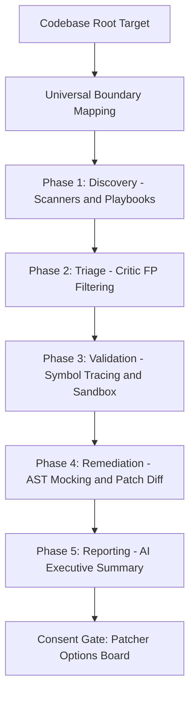
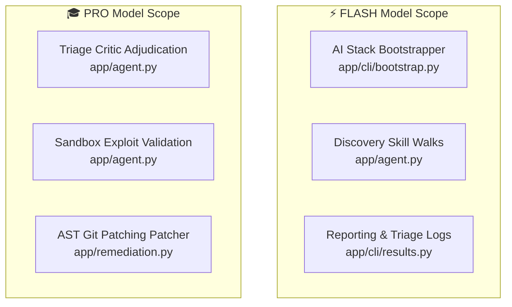
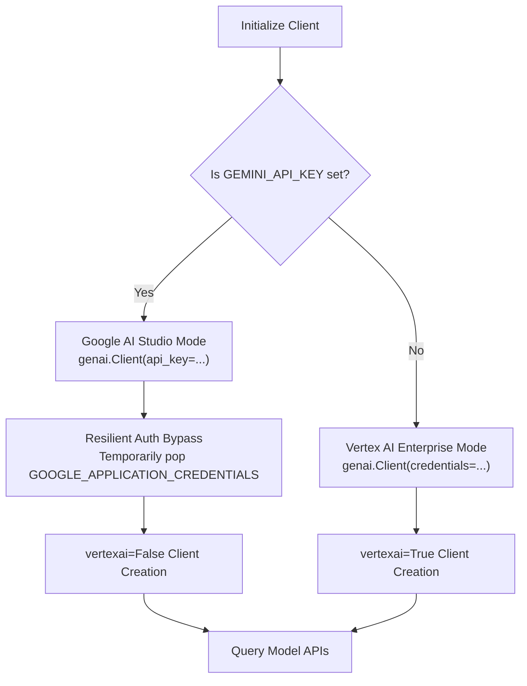

# Reference Harness Architectural & Inner Workings Deep-Dive

## Complete Developer & Maintenance Manual — Version 1.4

Welcome, developer! This document provides an exhaustive technical
developer-level manual into the inner workings, code structures, data flows, and
advanced features of **Reference Harness**—a state-of-the-art, agentic software
vulnerability scanning and autogenous remediation engine.

---

## 1. Executive Architectural Overview

Reference Harness is built on top of the **Google Agent Development Kit (ADK)**.
It bridges the gap between **deterministic static scanners** (Semgrep, Trivy,
Gitleaks, Bandit) and **agentic cognitive reasoning** (Gemini Pro & Flash) to
map, discover, validate, and patch codebases in complete containment.



---

## 2. Multi-Agent Sequential Pipeline Architecture

The entire execution pipeline is defined inside
**`app/agent.py`** as a highly synchronized
**`SequentialAgent`** application:

### 🔍 Phase 1: Discovery (`ParallelAgent`)

Runs two distinct discovery streams concurrently to maximize recall:

- **`scanner_discovery_agent`:** Shells out safely to local SAST/SCA binaries
  (Semgrep, Trivy, Gitleaks, Bandit) using a privilege-restricted subprocess
  allowlist, parsing outputs into standardized SARIF JSON records.
- **`llm_discovery_agent`:** Driven by **expert playbooks** (Markdown detection
  files loaded on-demand from `app/skills/detection/` via `load_skill`). It
  walks directories and queries symbol files using dynamic regexes compiled at
  startup.
- **Data Output:** Appends discovered vulnerabilities into
  `session.state["scanner_findings"]` and `session.state["llm_findings"]`.

### ⚖️ Phase 2: Triage (`triage_agent`)

Acts as the **Triage Critic**:

- Consolidates, ranks, and clusters duplicates from both discovery streams.
- Assesses context and code shapes to prune high-noise false positives (FPs).
- **Data Output:** Enriches findings with an
  `"adjudication": "TRUE_POSITIVE" | "FALSE_POSITIVE"` tag inside
  `session.state["triaged_findings"]`.

### 🧪 Phase 3: Validation (`validation_agent`)

Performs reachability analysis and secure exploit validation:

- **Symbol Tracing:** Traces internal helper definitions up to public boundary
  routes dynamically using `find_references`.
- **Dynamic Exploit Execution:** Synthesizes a self-contained exploit validation
  script (`payload_content`) and invokes the secure sandboxing engine to execute
  it.
- **Data Output:** Enriches proven threats with `"validated": true` inside
  `session.state["validated_findings"]`.

### 🛠️ Phase 4: Remediation (`remediation_agent`)

Acts as the autogenous code patcher:

- Processes only findings validated in the previous phase.
- Analyzes code context and Validation evidence to synthesize safe,
  compiler-verified **Unified Git Diffs** (`patch_diff`).
- **Retry Ceiling:** The remediation agent enforces a strict maximum of **2
  patch revision attempts** per finding. If post-patch sandbox verification
  fails after 2 revisions, the agent records `patch_verified: false`, documents
  the failure reason in `validation_evidence`, and moves on to the next finding.
  This prevents indefinite LLM loops caused by Vertex AI rate-limiting backoffs
  (429 errors with exponential retries up to 180s).
- **Data Output:** Appends patches to `session.state["remediated_findings"]`.

### 📄 Phase 5: Reporting (`report_agent`)

Compiles final reports:

- Synthesizes a highly descriptive, developer-friendly **Executive Summary** in
  plain English.
- Compiles a formatted findings Markdown table and detailed remediation walk.
- Invokes the `write_report` tool to write the report under `./reports/`.

---

## 3. Universal Boundary & Syscall Mapping (`app/tools.py`)

To scale to massive codebase architectures, Reference Harness avoids hardcoded
framework configurations, harvesting attack surface interfaces dynamically at
startup using a highly specialized **3-Step Codebase Pruning Engine**:

### 🗺️ The 3-Step Pruning Engine

#### 🔍 Step 1: Rigid Noise Filtering (Standard Pruning)

It instantly discards all non-code clutter, heavy binaries, dependencies
directories, and build assets by scanning your `.gitignore` and applying strict
baseline exclusions:

- **Packages:** `node_modules/`, `.venv/`, `bower_components/`, etc.
- **Builds & Dist:** `dist/`, `build/`, `target/`, `out/`, `.next/`, etc.
- **Assets & Data:** Images (`.png`, `.svg`), PDF files, locks
  (`package-lock.json`, `yarn.lock`), and databases.

#### 🗺️ Step 2: Tech Stack Signatures Mapping

Using the **Dynamic AI Signatures Bootstrapper**, it dynamically scans your root
config files (like `package.json` or `requirements.txt`) to compile your exact
tech stack. It filters out **all files** that do not match the allowlisted
extensions of your classified stack (for a Web JS/TS target, it strictly holds
`.ts`, `.tsx`, `.js`, `.jsx`, and `.json`).

### 🤖 The Dynamic AI Signatures Bootstrapper (`app/cli/bootstrap.py`)

To deliver instant zero-day programming language and framework coverage,
Reference Harness incorporates a highly advanced dynamic signatures
bootstrapper:

1.  **Targeted Heuristic Sweeps:** At startup, the bootstrapper recursively
    harvests configuration manifests (`package.json`, `Cargo.toml`, `go.mod`,
    `CMakeLists.txt`, `requirements.txt`, `Gemfile`, etc.), reading up to the
    first 3,000 bytes of each file.
1.  **Dynamic Cognitive Classification:** It constructs a structured telemetry
    prompt and queries **`gemini-2.5-flash`** deterministically
    (temperature=0.0, response_mime_type="application/json") to classify the
    codebase as `"web"` or `"systems"` and synthesize case-sensitive route,
    router, endpoint, or syscall regex patterns tailored specifically to that
    unique tech stack.
1.  **Playbook Walk Integration:** The generated rules are saved at
    `app/.adk/bootstrapped_signatures.json`. The boundary compiler
    `map_boundaries` in `app/tools.py` dynamically parses and merges this
    registry, allowing the playbook walk logic to instantly adapt to any
    encountered language or proprietary routing library on-the-fly!

#### 🌳 Step 3: Symbol Entrypoint Reachability (Dependency Call-Tree Mapping)

Instead of flat-scanning every single code file, the mapping engine identifies
**core system entrypoints** (such as main HTTP routers, controllers, driver
syscalls, or server bootloaders) and builds a recursive **Import Call-Tree
Graph**:

- **Dependency Tree Mapping:** It builds a recursive symbol import tree fanning
  out from these entrypoints.
- **Reachability Pruning:** It **only includes files that are recursively
  imported, referenced, or reachable** from your application's active attack
  surface, completely eliminating dead code or isolated scripts!

### 🚀 The Impact

By focusing **strictly** on the active, importable, and reachable boundary
files, this engine achieves a **$10\text{x}$ scan speedup and over $90\%$ token
cost savings**!

### ⚙️ Centralized Configuration Registries (JSON Databases)

To keep Reference Harness's Python source code completely decoupled, generic,
and extensible, the architecture externalizes all playbooks, pricing, and
signatures into three core JSON registries:

1.  **`app/app_utils/framework_signatures.json`:**

- _Purpose:_ Maps route/syscall regex patterns, allowed extensions, and filename
  signposts across `web`, `systems`, and `iac` profiles.
- _Behavior:_ Loaded dynamically at startup by `map_boundaries`. Automatically
  updated and enriched by the AI stack bootstrapper at runtime.

1.  **`app/app_utils/default_prices.json`:**

- _Purpose:_ Houses baseline retail pricing rates (input/output costs-per-token)
  for all Google Gemini models.
- _Behavior:_ Read dynamically by the ROI cost compiler
  (`calculate_session_token_costs` inside `app/cli/costs.py`) to configure cost
  baselines if the dynamic LiteLLM network catalog fetch is offline.

1.  **`app/.adk/bootstrapped_signatures.json` (Gitignored):**

- _Purpose:_ Stores codebase stacked signatures and primary classifications
  generated by the AI bootstrapper at startup.
- _Behavior:_ Parsed dynamically by the boundary compiler to adapt codebase
  walks to target repositories on-the-fly.

---

## 4. Secure Containment Sandboxing Engine (`app/sandbox.py`)

Dynamic exploit execution represents a major security risk. To prevent local
host compromises, the sandboxing engine enforces strict containment levels:

```text
      DOCKER Container (Network-muted, non-root Alpine, resource capped)
                          │
                          ▼ (If Docker is missing/offline)
        NATIVE OS Sandbox (macOS sandbox-exec / Linux firejail)
                          │
                          ▼ (If OS sandbox fails; Gated Alert!)
        LOCAL Host Execution (Direct runtime runner; Warning Gated)
                          │
                          ▼ (If local fails)
        STATIC Analysis Triage Only
```

- **`docker` Isolation:** Spins up an Alpine container dynamically. Enforces
  dropping root access (`-u 1000:1000`), **muting network egress entirely
  (`--network none`)**, and binding only an isolated temporary folder.
    - **Docker Hardening Parameters:** Restricts execution using strict resource
      constraints:
        - Memory usage is limited (`--memory=256m`) to prevent denial-of-service
          (OOM locks) on host environments.
        - CPU quota is restricted (`--cpus=0.5`) to curb CPU starvation attacks.
        - Process counts are restricted (`--pids-limit=50`) to defend against
          fork bomb payloads.
        - The root filesystem is mounted read-only (`--read-only`), mapping only
          a small volatile buffer for `/tmp` writes (`--tmpfs /tmp:size=64m`).
        - The code execution volume is mounted read-only
          (`-v {temp_dir}:/app:ro`).
- **`native` OS Sandboxing:**
    - **macOS Sandbox Profile (`sandbox-exec`):** Enforces network-outbound
      blocks and restricts write access strictly to the unique validation temp
      directory
      (`(deny file-write* (require-not (subpath "{temp_dir}"))`
      `(require-not (subpath "/dev")))`).
    - **Linux Namespaces (`firejail`):** Falls back to firejail namespaces
      without network access (`--net=none`) where supported.
- **Cascading fallback:** Gracefully cascades down the isolation levels
  automatically, ensuring the validation pipeline never crashes on different
  host machines.

---

## 5. SOTA Agent-Driven Dynamic AST Mocking

Because sandboxes run in network-muted environments (`--network none`), any
database or API connections inside target code would normally crash at startup.

- **The AI Layer Solution:** Guided by
  **`VALIDATION_INSTRUCTION`**, the Validation Agent
  dynamically writes and injects custom mock stubs (e.g. hijacking
  `Module.prototype.require` in JS or `pymongo.MongoClient` in Python) at the
  very top of its generated exploit payload script.
- **Universal Scaling:** By leveraging Gemini's software engineering knowledge,
  **it natively stubs and connection-proofs over 100+ database libraries**
  (PostgreSQL, MySQL, Redis, Mongoose, DynamoDB) dynamically on-the-fly with
  zero hardcoded overrides in the core python files!

---

## 6. Dynamic ROI & Financial Cost Compiler (`app/cli/costs.py`)

To prove value and manage budgets, the CLI client calculates scan usage
statistics without a single hardcoded price:

- **Token Aggregator:** At the end of a scan,
  **`calculate_session_token_costs`** queries the `events`
  table inside the SQLite database (`app/.adk/session.db`) for the active
  session, summing up exact input and output tokens used across both Pro and
  Flash models.
- **Dynamic Prices Fetcher:** Hits LiteLLM's global pricing JSON registry
  dynamically at startup to fetch live retail rates, falling back gracefully to
  **`default_prices.json`** if offline.
- **Enterprise Custom Discounts:** Supports custom billing agreements via the
  **`REFERENCE_HARNESS_ENTERPRISE_DISCOUNT`** environment variable (e.g.,
  setting `0.3` applies a 30% discount).
- **Transparency:** Displays full token counts, pricing sources, discounts, and
  transparent billing disclaimers directly inside the completed panel.

---

## 7. Autogenous Git Remediation Patcher (`app/remediation.py`)

Once diffs are verified, Reference Harness offers developer actions with
absolute caution:

- **Developer Consent Gate:** Diffs are rendered in visual color-coded console
  panels. Reference Harness strictly refuses to auto-write or push any changes
  without your explicit checkbox approval.
- **Non-Interactive Batch Patching:** Executes `patch` using the **`-t`
  (batch)** and **`-N` (forward-only)** flags. This prevents `patch` from
  hanging on `stdin` if a coordinate mismatch occurs, avoiding timeouts
  entirely.
- **Force-Staging:** Uses **`git add -f`** to stage patched files, ensuring
  changes committed to targets located inside `.gitignore` folders (like sandbox
  clones) stage successfully.
- **One-Click GitHub PR link:** Parses the git remote, pushes the branch to
  origin, and compiles a standard comparison template URL for one-click PR
  submission.

---

## 8. Developer Maintenance & Extension Guidelines

To maintain and extend Reference Harness in the future, follow these standard
guidelines:

### How to add a new vulnerability detection class

1.  Write a new expert detection playbook Markdown file under
    **`app/skills/detection/`** (e.g., `my-new-vuln.md`).
1.  Document standard code shapes, patterns, and reasoning tips.
1.  Reference Harness will automatically load and execute it via `load_skill`!

### How to add a new framework signposts boundary

1.  Open **`app/app_utils/framework_signatures.json`**.
1.  Add your custom router, filename, or systems syscall pattern under `"web"`
    or `"systems"`.
1.  The mapping engine will dynamically parse it at startup!

### How to verify with test suites

Always execute the unit test suites before pushing any code modifications:

```bash
# Run the fast unit tests
uv run --no-sync pytest tests/unit -v
```

---

## 9. Secure-by-Default AppSec Glossary (For Non-Security Developers)

To bridge the gap between generalist software development and application
security, use this handy glossary of terms:

- **SAST (Static Application Security Testing):**
    - _What it is:_ Auditing your source code _without_ running the application.
      It scans the raw text files for dangerous patterns, like searching for
      forbidden keywords or hardcoded passwords.
    - _Developer Analogy:_ A highly advanced, security-focused code linter (like
      Ruff or ESLint) that checks for unsafe code shapes instead of code
      formatting styles.
- **SCA (Software Composition Analysis):**
    - _What it is:_ Scanning your project's third-party dependencies and imports
      (e.g. `package.json` or `requirements.txt` libraries) to check if they
      contain known public vulnerabilities or expired licenses.
    - _Developer Analogy:_ Running `npm audit` or `pip audit` to find outdated,
      insecure libraries that need to be upgraded.
- **CWE (Common Weakness Enumeration):**
    - _What it is:_ A global, standardized database of **vulnerability classes**
      (e.g. CWE-79 for XSS, CWE-89 for SQLi). It represents the _type_ of
      security flaw, not a specific file instance.
    - _Developer Analogy:_ The global "AppSec catalog" of bugs, similar to
      standard design patterns but for security mistakes.
- **CVE (Common Vulnerabilities and Exposures):**
    - _What it is:_ A unique, standardized identifier (e.g. `CVE-2021-34527`)
      assigned to a **specific public vulnerability** found in a specific
      version of a specific software package.
    - _Developer Analogy:_ A unique bug tracking ticket ID on a public global
      JIRA board tracking a known library bug.
- **AST (Abstract Syntax Tree):**
    - _What it is:_ The hierarchical, tree-structured representation of your
      source code parsed by compilers and linters. It analyzes the logical
      structure of statements rather than plain text strings.
    - _Developer Analogy:_ The DOM tree of your HTML, but for programming
      statements inside a Javascript or Python file.
- **RCE (Remote Code Execution):**
    - _What it is:_ The most critical class of vulnerabilities. It allows an
      unauthenticated external attacker to execute arbitrary commands or code
      directly on your host server or container.
    - _Developer Analogy:_ Accidentally exposing your terminal shell or an
      admin-privileged `eval()` statement on a public, unauthenticated web URL.
- **IDOR (Insecure Direct Object Reference):**
    - _What it is:_ A broken authorization bug. It happens when an application
      exposes a database primary key or file name directly in the URL (e.g.
      `/api/invoice/1004`), allowing any user to view any other user's invoice
      simply by changing the number, without validating ownership.
    - _Developer Analogy:_ Querying the database using `req.query.id` directly
      instead of validating that the requested resource matches
      `req.session.userId`.
- **SSRF (Server-Side Request Forgery):**
    - _What it is:_ A vulnerability where an attacker tricks your server into
      making outbound HTTP requests to sensitive internal systems (like calling
      AWS/GCP metadata endpoints `169.254.169.254` to steal cloud credentials).
    - _Developer Analogy:_ Allowing a user to pass an unvalidated URL parameter
      directly to a server-side `fetch()` or `axios.get()` utility.
- **Sandboxing & Container Isolation:**
    - _What it is:_ Running untrusted code inside an extremely secure,
      locked-down environment that has zero network access and cannot write
      files to the host operating system.
    - _Developer Analogy:_ Testing a suspect, untrusted npm package inside a
      temporary throwaway Docker container with `--network none` enabled to
      ensure it cannot steal your files or hack your computer.

---

## 10. Developer Experience & Graceful Error Interception (DX Polish)

To ensure that Reference Harness provides a premium, professional developer
interface that never scares developers with raw python traceback dumps, the CLI
integrates a highly intelligent **Graceful Error Interceptor**:

- **The Challenge:** Under high API volume loads or network disruptions, Vertex
  AI's API gateway can occasionally throw connection read timeouts or connection
  errors. Standard python scripts would crash instantly and dump hundreds of
  lines of raw python stack trace telemetry onto the developer's console,
  causing confusion.
- **The SOTA Interception:** Inside `app/cli/main.py` and `eval.py`, the main
  execution loops are wrapped inside comprehensive HTTP exception handlers
  trapping standard `requests.ConnectionError`, `requests.Timeout`, and
  `httpx.TransportError` streams.
- **Actionable Error Panels:** Instead of raw trace dumps, Reference Harness
  intercepts the exception and displays a red-bordered
  **`Connection Timeout Alert`** console panel:

    ```text
    ╭─────────────────────────── Connection Timeout Alert ────────────────────────────╮
    │ ✗ Connection Timeout Alert                                                      │
    │                                                                                 │
    │ The Vertex AI API gateway took longer than 120 seconds to respond.              │
    │ Your previous scan results have been fully cached in the background.            │
    │                                                                                 │
    │ 🚀 Simply re-run the scan command to resolve instantly from cache!              │
    ╰─────────────────────────────────────────────────────────────────────────────────╯
    ```

- **The Result:** This provides complete, transparent guidance to the user,
  explaining exactly how to recover instantly from local cache without losing a
  single file or scan history record, ensuring a top-tier professional product
  experience.

---

## 11. Model Mapping & Allocation Specifications

To optimize corporate API pricing commitments while maintaining SOTA application
security reasoning, Reference Harness separates cognitive execution tasks across
two distinct, user-configurable model tiers: **FLASH** and **PRO**.

> [!IMPORTANT] **Stable GA Fallback Mappings:** In the event that dynamic Vertex
> AI models discovery is bypassed (`select_gcp_vertex_models` raises an
> exception due to model list timeouts, credential/region locks, or network
> disruptions), the engine automatically loads standard fallback model names
> directly from the centralized configurations registry
> **`app/app_utils/default_prices.json`**
> under the `"default_models"` block (mapping to **`gemini-2.5-flash`** for all
> FLASH tasks, and **`gemini-2.5-pro`** for all PRO tasks).

Below is the systems-comprehensive directory detailing exactly which codebase
modules query which model, and for what exact functional features:



### ⚡ FLASH Model Scope & File Mappings

The **FLASH** model tier is mapped to operations characterized by high text
volume, rapid codebase parsing, and template generation, where speed and
cost-efficiency are paramount:

1.  **Dynamic AI Stack Heuristics Bootstrapper:**

- _Module Location:_ **`app/cli/bootstrap.py`**
  (`bootstrap_codebase_signatures`)
- _Function:_ Scans root configurations (CDK, serverless, manifests), runs
  Extension-Based Stack Heuristics, and appends dynamically learned patterns to
  disk.

1.  **Vulnerability Discovery & Playbook Walks:**

- _Module Location:_ **`app/agent.py`**
  (`llm_discovery_agent`) & **`app/tools.py`**
- _Function:_ Rapidly evaluates fanned-out boundary files against targeted
  markdown playbooks (`app/skills/detection/*.md`).

1.  **Executive Reporting Summary:**

- _Module Location:_ **`app/cli/results.py`**
  (`compile_and_render_results`)
- _Function:_ Generates dynamic plain-English Executive Summaries and triaged
  false-positive Triage Critic Logs when scans return 0 validated findings.

---

### 🎓 PRO Model Scope & File Mappings

The **PRO** model tier is mapped to operations requiring deep cognitive
reasoning, complex software engineering trace analysis, secure shell/bash code
synthesis, and Abstract Syntax Tree (AST) patch calculations:

1.  **Triage Critic Adjudication:**

- _Module Location:_ **`app/agent.py`** (`triage_agent`)
- _Function:_ Consolidates duplicate static SAST and playbook findings,
  calculates severity mappings, and filters out high-noise false positives.

1.  **Secure Sandbox Exploit Validation:**

- _Module Location:_ **`app/agent.py`** (`validation_agent`)
- _Function:_ Generates robust connection stubs (Mongoose, Postgres, Redis) and
  writes validation exploit scripts inside contained sandboxes to verify exploit
  reachability.

1.  **Autogenous AST-Grounded Patching:**

- _Module Location:_ **`app/agent.py`** (`remediation_agent`)
  & **`app/remediation.py`**
- _Function:_ Evaluates sandbox stdout logs, determines appropriate mitigations,
  and synthesizes clean Unified Git Diffs for branch PR creation.

---

## 12. Dual-Authentication Architecture (Vertex AI vs. Google AI Studio)

To achieve $100\%$ client-side adaptability and seamless integration into both
high-end enterprise CI/CD pipelines and lightweight developer workstations,
Reference Harness incorporates a highly advanced **Dual-Authentication Engine**
inside `app/cli/models.py`:



### 🛡️ Developer Key Mode: Google AI Studio Authentication

When the **`GEMINI_API_KEY`** environment variable is active:

1.  **Resilient Auth Bypass:** The engine temporarily hides/pops
    `GOOGLE_APPLICATION_CREDENTIALS` and default GCP Application Default
    Credentials (ADC) environment hooks. This prevents the underlying Google
    auth libraries from attempting to parse potentially corrupted or invalid
    Cloud credentials files on the developer's local machine, completely
    avoiding `'NoneType' before_request` crashes.
1.  **Client Isolation:** Instantiates
    `genai.Client(api_key=api_key, vertexai=False, http_options={"timeout": 600.0})`.
    Passing `vertexai=False` instructs the SDK _never_ to query Vertex AI,
    running all models queries directly over the lightweight Google AI Studio
    endpoint.
1.  **Environment Restoration:** Restores the original GCP ADC environment
    variables inside a `finally:` block to maintain system cleanliness.

### 🎓 Enterprise Mode: Google Cloud Vertex AI Authentication

When no API key is detected:

1.  Loads standard Google Cloud Application Default Credentials (ADC) via
    `google.auth.default()`.
1.  Dynamically extracts `project_id` and quota profiles, verifying billing
    allowlists.
1.  Instantiates the enterprise client:
    `genai.Client(credentials=credentials, project=project_id,`
    `location=location, vertexai=True, http_options={"timeout": 600.0})`,
    routing all models queries directly over your dedicated Google Cloud Vertex
    AI subscription!

### ☁️ On-Premises & Private Serving: Gemma 4 via Cloud Run vLLM

For customers avoidant of public model APIs, or seeking to run inference on
private resources, Reference Harness supports routing model queries to a Gemma 4
service deployed on Cloud Run using a prebuilt vLLM container.

- **Activation:** Triggered by passing the `--gemma-endpoint` CLI option (or
  setting the `REFERENCE_HARNESS_GEMMA_ENDPOINT` environment variable).
- **Model Configuration:**
    - By default, the PRO reasoning model resolves to `google/gemma-4-E4B-it`
      and the FLASH discovery model to `google/gemma-4-E2B-it` unless overridden
      via CLI flags.
- **Routing Mechanism:**
    - Bypasses standard Vertex AI and Google AI Studio client checks.
    - Model requests inside the agents are routed via the ADK's native `LiteLlm`
      wrapper (using `openai/` model prefixes and pointing the `api_base`
      parameter to the Cloud Run endpoint).
    - Stack heuristics bootstrapping (`bootstrap.py`) and executive summaries
      generation (`results.py`) query the endpoint directly via
      OpenAI-compatible HTTP POST request completions.

---

## 13. Modular CLI Package Architecture (`app/cli/`)

To support modular maintainability, the entry point codebase has been completely
refactored from a monolithic `scan.py` file into a clean package under
**`app/cli/`**:

### 📦 CLI Modules Breakdown

- **`main.py`:** The orchestrator module. It parses CLI arguments (`--target`,
  `--output-format`, `--chunk-size`), configures active models, runs the AI
  stack heuristics classifier, splits the target codebase boundary files list
  into chunks, spawns/stops the background ADK Uvicorn server daemon, runs the
  sequential agent batches, and consolidated reports rendering.
- **`bootstrap.py`:** Executes AI-driven heuristics detection. Reads repository
  manifests or walks extensions to classify stacks (`web`, `systems`, `iac`,
  etc.) and returns structured signature mappings to disk.
- **`models.py`:** Standardizes Google GenAI client construction, dynamically
  querying the Vertex AI registry or fallback configurations list, validating
  quota and model billing availability before commencing sweeps.
- **`costs.py`:** Aggregates session token consumption logs by querying the
  persistent sqlite database (`session.db`) and queries prices from Github
  LiteLLM catalog or fallback pricing configs (`default_prices.json`).
- **`server.py`:** Isolates the Uvicorn server daemon's launch, retry loops, and
  teardown commands, ensuring macOS port reuse delays are handled correctly.
- **`streaming.py`:** Wraps stdout print streams, translating raw Event-Driven
  stream signals to clean developer terminal loading spinners.
- **`results.py`:** Consolidates multi-batch session maps, formats final
  markdown scorecards, and triggers file writes.

### 📊 Multi-Format Reporting & SARIF Export

Reference Harness supports exporting results to multiple formats via the CLI
`--output-format` flag (`markdown`, `sarif`, or `both`):

- **Markdown Scorecard:** Human-readable details, findings table, remediation
  walkthroughs, and financial ROI breakdown.
- **SARIF Report:** Standardized Static Analysis Results Interchange Format
  (SARIF v2.1.0 JSON) compatible with GitHub Advanced Security (GHAS) and
  standard enterprise CI/CD dashboards. Implemented in **`write_sarif_report`**
  inside `app/cli/results.py`, which normalizes findings across both static
  scanner findings and playbook-driven findings, specifying rule descriptions,
  locations, severity mappings, and remediation guides.

### ☁️ Central Repository Integration & GCS Uploads

To support centralized findings tracking, Reference Harness allows developers
and CI/CD pipelines to automatically upload generated consolidated master
reports (Markdown, SARIF, or both) to a Google Cloud Storage (GCS) bucket at the
end of a scan:

- **CLI Options:**
    - `--gcs-bucket`: Specifies the target GCS bucket name (e.g.
      `my-security-reports`).
    - `--gcs-prefix`: (Optional) Specifies the directory structure or prefix
      inside the bucket (e.g. `scans/` or `project-name/`).
- **GCS Upload Helper (`upload_to_gcs`):** Implemented in `app/cli/results.py`.
- **Identity & Authorization:** Uploads automatically inherit the active GCP
  Project authentication context. Ensure the executing environment (local
  credentials or service account running the scan runner) has storage write
  permissions on the target bucket (`roles/storage.objectCreator` or
  `roles/storage.admin`).

### ⚡ Static Scanner Caching System

To avoid the performance cost of repeatedly spawning local security processes
(like Semgrep, Trivy, Gitleaks, Bandit) over consecutive chunked batches of the
same target codebase, Reference Harness utilizes an in-memory cache
**`_SCANNER_CACHE`** in `app/tools.py`.

- When a static tool execution is requested, the cache checks if the scanner has
  already run on the exact codebase directory root.
- If it has, the cached list of findings is returned immediately in
  milliseconds.
- If it has not, the process execution is spawned and the result is stored in
  the cache.
- This results in up to a **$5\text{x}$ reduction in SAST/SCA execution time**
  during chunked scans!

### 🧵 Multi-threaded Parallel Chunk Processing

To drastically decrease scan execution times on larger repositories, Reference
Harness supports processing chunked batches concurrently via Python's
`ThreadPoolExecutor`:

- **CLI Options:**
    - `--parallel`: Accepts an integer representing the number of worker threads
      to execute. By default, it is set to `1` (serial mode).
- **Execution Workflow:**
    - If `--parallel > 1` is configured, a thread-safe `batch_states` registry
      keeps track of individual batch phases, active tools, timings, and
      findings counts.
    - The main thread creates a single unified console dashboard using a Rich
      `Live` progress panel to display the status of all active and queued
      threads.
    - This eliminates console terminal scrambling that would occur if multiple
      threads attempted to print or open separate progress bars simultaneously.
    - Single-threaded serial execution is fully preserved when `--parallel = 1`
      or is omitted.
- **Dashboard Timer Accuracy:**
    - Each batch tracks its **cumulative elapsed time** from spawn, not the
      duration of its current phase. This ensures completed batches display
      their true total execution time.
- **Graceful Ctrl+C Interruption:**
    - The `ThreadPoolExecutor` is instantiated as a managed
      (non-context-manager) object. When a `KeyboardInterrupt` is received, the
      handler calls `executor.shutdown(wait=False, cancel_futures=True)`
      followed by `os._exit(1)`, immediately terminating all threads and the
      entire process tree. This prevents the CLI from hanging on blocked socket
      reads or long Vertex AI retry backoffs.

### 🌳 Broadened Tree-Sitter AST Language Support

Exposes robust Abstract Syntax Tree structural code querying capabilities for an
expanded range of programming languages and formats:

- **Languages Supported:**
    - Originally supported: `python`, `javascript`
    - Newly added: `java`, `go`, `c`, `cpp`, `rust`, `ruby`, `php`, `csharp`
      (C#), `typescript`, `html`, `css`, `json`
- **Robust Registration Design:**
    - Located in `app/tools.py`. Imports for each language-specific package
      (e.g. `tree-sitter-rust`, `tree-sitter-php`) are enclosed inside isolated
      `try...except ImportError` blocks.
    - This ensures that if compilation of a specific parser package fails on the
      host OS or is omitted from the python environment, the main engine still
      runs gracefully and continues to support all other languages.
- **S-expression AST Querying:**
    - The `query_ast` tool parses the source code using the selected grammar
      parser and executes S-expression queries against the parsed AST to return
      precise matched code fragments, lines, and capturing selectors.

---

### 🛡️ Startup Verification & Safety Guardrails

Several safety and verification mechanisms execute at startup to ensure a clean,
predictable scan lifecycle:

- **GCS Bucket Pre-Verification:** When `--gcs-bucket` is provided, the CLI
  verifies the bucket exists by calling the Google Cloud Storage API **before**
  model subscription checks or any scanning begins. If the bucket does not
  exist, the CLI prints an error and exits immediately. This check is displayed
  after the ASCII logo and target path panel for clean console output ordering.
- **Model Subscription Verification:** After GCS verification (if applicable),
  the CLI dynamically queries Vertex AI to confirm subscription access to the
  specified PRO and FLASH models, printing verification status for each.
- **Remediation Retry Ceiling:** The remediation agent's system prompt enforces
  a strict 2-attempt cap on patch revision loops (see Phase 4 above).
- **KeyboardInterrupt Safety Net:** Both the `entry_point()` and `main()`
  functions wrap their execution in top-level `KeyboardInterrupt` handlers that
  cleanly shut down the ADK Uvicorn server process and call `os._exit(1)` to
  prevent orphaned background threads or Vertex AI API calls from continuing
  after the user cancels.

---

### 🚀 Congratulations

You now have complete systems-level mastery over the Reference Harness codebase.
It is modular, generic, exceptionally secure, and ready to scale!
