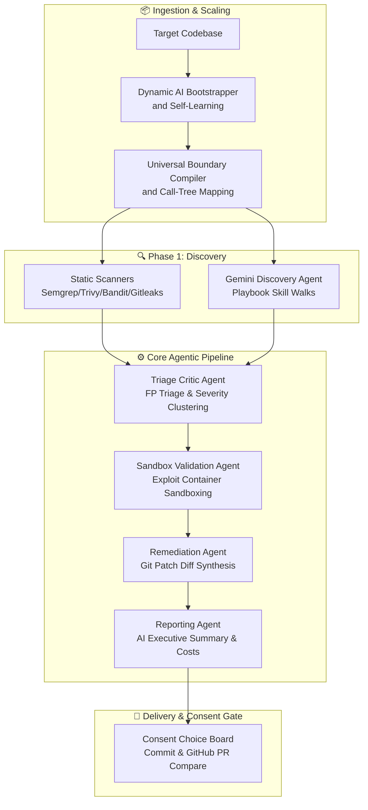
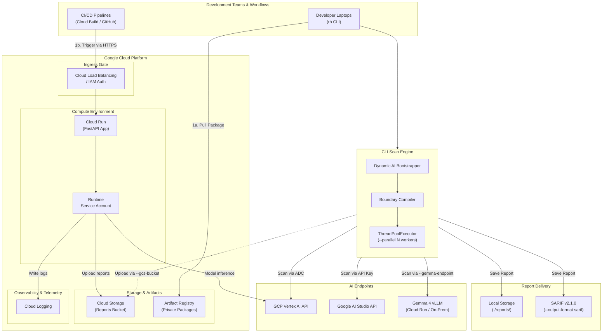

# Reference Harness

A generalist software vulnerability scanning agent built on
[Google ADK](https://adk.dev/).

It pairs the deterministic strengths of mature open-source scanners (Semgrep,
Trivy, Gitleaks, Bandit) with an **AI-driven discovery agent** that explores the
codebase directly and reasons about vulnerabilities — including logic flaws,
broken auth, and multi-step exploit setups that signature-based scanners miss.
Downstream LLM phases dedupe findings, validate them against the surrounding
code, and chain individually-low-severity issues into composite exploit paths.

> **Status: Production-Ready Release Candidate shipped!** The entire end-to-end
> agentic security pipeline is fully operational, integrating **Semgrep, Trivy,
> Bandit, and Gitleaks** in parallel with our dynamic AI-driven Playbook
> discovery agent. Downstream expert phases are fully live: **Triage Critic FP
> filtering**, **Secure Containment Sandboxed Exploit Validation** (supporting
> Docker, macOS sandbox-exec, and Linux firejail), and **Autogenous AST-Grounded
> Git Patch Remediation** (generating color-coded diff choices boards and
> automated GitHub Pull Requests). The engine features a SOTA **Dynamic AI
> Signatures Bootstrapper** that recursively sweeps stacks, dynamically
> auto-detects hybrid repositories, and permanently self-learns framework
> signatures on disk. It compiles real-time, dynamic **ROI cost and pricing
> spreadsheets** automatically at startup. Complete generalization validated on
> **OWASP NodeGoat** and a synthetic per-skill corpus at 100% recalls and 0%
> False Positives!

## How it works



The Gemini half of discovery orchestrates a **skill directory**
(`app/skills/detection/*.md`) — one focused playbook per vuln class (CSRF, IDOR,
SSRF, etc.) — via a `load_skill` tool. New vuln classes are added by dropping in
a Markdown file, not by editing the prompt. See
[`DESIGN_SPEC.md §Skills`](./DESIGN_SPEC.md#skills-llm-discovery-agents-detection-playbooks)
for the rationale.

Sub-agents communicate through ADK `session.state` via `output_key`
(`scanner_findings`, `llm_findings`, `triaged_findings`, `validated_findings`).
A `ScannerAllowlistPlugin` (defense-in-depth) blocks any tool call outside the
explicit allowlist.

## Deployment & Integration Architecture

Reference Harness can be executed locally on developer devices or deployed in
Google Cloud Platform (GCP) using containerized services or internal CLI
distributions.



### Distribution and Deployment Options

#### Option A: Centralized Service API (Cloud Run)

This pattern is designed for automated CI/CD pipelines (such as GitHub Actions
or GitLab CI) and internal team portals.

- **Hosting Service:** The codebase is containerized using the provided
  `Dockerfile` and deployed to **Google Cloud Run**. Cloud Run handles scaling
  and requests.
- **Authentication:** The Cloud Run service inherits identity from an attached
  runtime GCP service account, eliminating the need for static API keys.
- **API Endpoint:** Access is managed via standard HTTPS requests routed through
  Cloud Load Balancing and governed by IAM policies.

#### Option B: Local Developer CLI (Artifact Registry)

This pattern is designed for local development, pre-commit hooks, and ad-hoc
developer scans.

- **Package Registry:** The application is packaged as a Python wheel (with a
  registered `rh` console entry point) and hosted in a private **Google Cloud
  Artifact Registry** Python repository.
- **Installation:** Developers install the CLI directly using local package
  managers:

    ```bash
    uv tool install --extra-index-url https://<region>-python.pkg.dev/<project-id>/<repo-name>/ rh
    ```

- **Local Authentication:** The CLI supports three model
  execution/authentication modes:
    - **Google AI Studio (Developer Key Mode):** Developers use their personal
      static key by exporting `GEMINI_API_KEY` in their terminal, bypassing
      Google Cloud authentication and enterprise billing.
    - **GCP Vertex AI (Local Enterprise Mode):** The CLI queries Vertex AI using
      local Application Default Credentials (ADC) configured via
      `gcloud auth application-default login`.
    - **Private Gemma 4 (On-Premises Mode):** Route all inference to a
      self-hosted Gemma 4 vLLM endpoint via the `--gemma-endpoint` flag, keeping
      all data on-premises.
- **Parallel Scanning:** Accelerate audits on large codebases with
  `--parallel N` to fan chunked batches across N concurrent worker threads,
  monitored via a unified Rich terminal dashboard.
- **Report Storage:** Vulnerability reports are generated and written directly
  to the local filesystem under the `./reports/` directory. Optionally, reports
  can be automatically uploaded to a GCS bucket using
  `--gcs-bucket <bucket-name>` (with an optional `--gcs-prefix`).

### IAM & Authentication Policy

Security configurations enforce least-privilege access control using GCP IAM
roles:

- **Vertex AI Access:** The runner service account requires the
  `roles/aiplatform.user` role to access the Vertex AI Gemini models.
- **Storage Access:** The runtime identity requires `roles/storage.objectAdmin`
  on the designated reports bucket to upload system artifacts. For local GCS
  uploads via `--gcs-bucket`, the executing user or service account needs
  `roles/storage.objectCreator` on the target bucket.
- **Pipeline Federation:** External CI/CD pipelines communicate with GCP using
  **Workload Identity Federation**, removing the requirement for long-lived
  service account JSON keys.

### Storage & Telemetry Configurations

- **Local Reports:** Scan results are always written to the local `./reports/`
  directory in Markdown, SARIF, or both formats (controlled via
  `--output-format`).
- **GCS Auto-Upload:** When `--gcs-bucket` is specified, the CLI verifies bucket
  existence at startup and automatically uploads the generated master reports on
  completion.
- **Structured Logs:** System execution details stream automatically to **Cloud
  Logging**.
- **Performance Tracing:** Activating `otel_to_cloud=True` in
  `app/fast_api_app.py` streams execution metrics and agent steps directly to
  **Cloud Trace** and **Cloud Monitoring**.

## Setup

One-time, in this order:

### 1. Choose Authentication Method

#### Option A: Google Cloud Vertex AI (Enterprise Mode)

Uses Google Cloud Application Default Credentials (ADC) and enterprise billing:

```bash
# Auth via gcloud SDK (Install: https://cloud.google.com/sdk/docs/install)
gcloud auth login
gcloud auth application-default login
gcloud config set project YOUR_PROJECT_ID
gcloud services enable aiplatform.googleapis.com
```

- **Third-Party Models (Anthropic Claude on Vertex AI):** Reference Harness
  fully supports Anthropic Claude (Opus, Sonnet, Haiku) and other non-Gemini
  Vertex AI publisher models natively via its LiteLLM ADK integration. To use
  Claude, pass the exact model slug with the `vertex_ai/` prefix and explicitly
  set `--location global` (as Anthropic Vertex endpoints are globally routed):

    ```bash
    rh /path/to/code --pro-model vertex_ai/claude-3-5-sonnet --flash-model vertex_ai/claude-3-haiku --location global
    ```

#### Option B: Google AI Studio (Developer Key Mode - Recommended)

Enables lightweight local scans on developer laptops, bypassing Google Cloud
billing:

1.  Go to **[Google AI Studio](https://aistudio.google.com/)** and log in.
1.  Click **"Get API Key"** -> **"Create API Key"** and copy your key.
1.  Export the key in your terminal session:

```bash
export GEMINI_API_KEY="AIzaSyYourAPIKeyHere"
```

### 2. Install uv + CLI tools

You can install `uv` and the required CLI scanners using the following commands:

```bash
# Install uv + CLI tools
curl -LsSf https://astral.sh/uv/install.sh | sh
uv tool install "google-agents-cli>=0.2.0"
```

### 📦 Recommended: Isolated Virtual-Environment Installation (Zero-Sudo)

To install the SAST and secrets scanners directly inside your virtual
environment (requiring absolutely **zero admin or sudo privileges**), run these
commands inside the project directory:

```bash
# Install Semgrep SAST package
uv pip install semgrep

# Install Gitleaks binary (macOS Apple Silicon arm64 example)
curl -sSLo gitleaks.tar.gz https://github.com/gitleaks/gitleaks/releases/download/v8.18.2/gitleaks_8.18.2_darwin_arm64.tar.gz
tar -xzf gitleaks.tar.gz gitleaks
mv gitleaks .venv/bin/
rm gitleaks.tar.gz
```

### 🌐 System-Wide Installation (Optional)

Alternatively, you can install the scanners system-wide using Homebrew or
standard installer scripts:

```bash
# On macOS:
brew install semgrep gitleaks trivy

# On Linux / Manual Installers:
# Install Trivy (vulnerable-dependency / secrets / IaC scanner)
mkdir -p ~/.local/bin
curl -sfL https://raw.githubusercontent.com/aquasecurity/trivy/main/contrib/install.sh \
    | sh -s -- -b ~/.local/bin

# Install Bandit (Python SAST scanner)
uv pip install --index-url https://pypi.org/simple bandit

# Optional: Install ripgrep (speeds up Gemini discovery grep_code tool)
# (apt: `apt install ripgrep`, brew: `brew install ripgrep`)

# Optional: Install Tree-sitter AST structural querying engine
uv pip install --index-url https://pypi.org/simple \
    tree-sitter \
    tree-sitter-python tree-sitter-javascript \
    tree-sitter-java tree-sitter-go \
    tree-sitter-c tree-sitter-cpp \
    tree-sitter-rust tree-sitter-ruby \
    tree-sitter-php tree-sitter-c-sharp \
    tree-sitter-typescript tree-sitter-html \
    tree-sitter-css tree-sitter-json
```

### Private Registry / 401 Unauthorized Workaround

If your corporate environment maps custom/private Artifact Registry indices
(which can cause `uv` dependency checks to fail with `401 Unauthorized` or local
server timeout errors at startup), you should use the following workarounds:

#### Standard Scans

Bypass startup checks by prepending `UV_NO_SYNC=1` to your CLI command:

```bash
UV_NO_SYNC=1 agents-cli run "Scan /tmp/demo-target for vulnerabilities and write a report."
```

#### Evaluation Runs

Prepend `UV_DEFAULT_INDEX=https://pypi.org/simple` to force the evaluation's
internal sync subprocess to resolve packages directly from PyPI:

```bash
UV_DEFAULT_INDEX=https://pypi.org/simple agents-cli eval run --evalset tests/eval/evalsets/rh_nodegoat.evalset.json
```

### 3. Clone the project

```bash
git clone https://github.com/GoogleCloudPlatform/cloud-solutions.git
cd projects/reference-harness
```

### 4. Install project dependencies

This command creates `.venv/` and installs all required libraries in editable
mode:

```bash
agents-cli install
```

The agent picks up your project ID from ADC via `google.auth.default()` and
forces `location=global` for Vertex. Override either with `GOOGLE_CLOUD_PROJECT`
/ `GOOGLE_CLOUD_LOCATION` if you're scanning in a different account.

## Demo

The fastest way to see it work — drop a small vulnerable file into a temp
directory and scan it. Run all of this from inside the project folder
(`agents-cli` discovers `app/` relative to CWD, and reports are written to
`./reports/`):

```bash
cd projects/reference-harness

# 1. Create a target with a few obvious vulnerabilities
mkdir -p /tmp/demo-target
cat > /tmp/demo-target/app.py <<'EOF'
import subprocess
from flask import Flask, request

app = Flask(__name__)

@app.route("/calc")
def calc():
    return str(eval(request.args.get("expr", "0")))  # RCE

@app.route("/run")
def run_cmd():
    name = request.args.get("name", "")
    return subprocess.check_output(f"echo hi {name}", shell=True)  # cmd injection

if __name__ == "__main__":
    app.run(host="0.0.0.0", debug=True)  # debug + bind-all
EOF
```

### 2. Run the Agent (Single Shot, Non-Interactive)

You can execute the security audit against the target using two visual output
styles:

#### 🚀 Option A: Modern Graphical Progress View (Recommended)

Runs silently in the background with a sleek terminal progress spinner,
real-time stopwatches, and a clean summary panel:

```bash
# Via installed CLI entry point
rh /tmp/demo-target

# Or via uv run
uv run rh /tmp/demo-target
```

#### 💻 Option B: Standard Raw CLI Output

Runs the raw ADK server binary directly, printing full Uvicorn startups and
telemetry logs:

```bash
UV_NO_SYNC=1 agents-cli run "Scan /tmp/demo-target for vulnerabilities and write a report."
```

### ⚙️ CLI Parameters & Options

The `rh` CLI supports several command-line parameters to customize the scan
engine, model selection, batching size, and deep scanning behavior:

| Parameter          | Type         | Default    | Description                                                                                                                                                                                    |
| :----------------- | :----------- | :--------- | :--------------------------------------------------------------------------------------------------------------------------------------------------------------------------------------------- |
| `target_dir`       | _Positional_ | _Required_ | Target directory path to scan (e.g., `/tmp/demo-target`).                                                                                                                                      |
| `--scan-all`       | Flag         | `False`    | **Deep Scan Mode:** Bypasses reachability and boundary filters, force-mapping and deep-scanning every single source file in the directory. Use this to audit standalone or disconnected files. |
| `--pro-model`      | String       | _Dynamic_  | Override the deep-reasoning **PRO** model name (e.g., `gemini-2.5-pro`).                                                                                                                       |
| `--flash-model`    | String       | _Dynamic_  | Override the fast-discovery **FLASH** model name (e.g., `gemini-2.5-flash`).                                                                                                                   |
| `--location`       | String       | _Dynamic_  | Override the GCP Vertex AI region location (e.g., `us-central1`, `europe-west1`).                                                                                                              |
| `--chunk-size`     | Integer      | `25`       | Override the maximum number of boundary files processed in each chunk batch.                                                                                                                   |
| `--parallel`       | Integer      | `1`        | Number of concurrent worker threads to execute chunked batches. Set > 1 to enable concurrent scanning.                                                                                         |
| `--output-format`  | String       | `markdown` | The output report format. Choices: `markdown`, `sarif`, or `both`.                                                                                                                             |
| `--gcs-bucket`     | String       | _None_     | Destination GCS bucket name to automatically upload the master scan reports. Bucket existence is verified at startup before scanning begins.                                                   |
| `--gcs-prefix`     | String       | `""`       | Optional folder prefix path inside the GCS bucket.                                                                                                                                             |
| `--gemma-endpoint` | String       | _None_     | Custom endpoint URL (e.g., Cloud Run vLLM) for querying private Gemma 4 models.                                                                                                                |

#### Parameter Usage Examples

```bash
# Basic scan with parallel workers and GCS upload
rh /tmp/demo-target --parallel 4 --gcs-bucket my-reports --gcs-prefix audits/

# Deep scan with model overrides and dual output
rh /tmp/demo-target --scan-all --pro-model gemini-2.5-pro --flash-model gemini-2.5-flash --output-format both --chunk-size 15
```

## 3. Read the Produced Report

Once completed, you can list and inspect the latest generated audit reports
using:

```bash
ls -t reports/ | head -1
cat "reports/$(ls -t reports/ | head -1)"
```

Expected: a Markdown report under `./reports/` listing the planted
vulnerabilities (eval-based RCE, command injection, Flask debug, bind-all host)
with per-finding evidence drawn from the source.

### Sample report

```markdown
# Reference Harness report — 2024-05-20T10:00:00Z

## Executive summary
The security scan identified 4 validated vulnerabilities in the application,
including critical remote code execution and command injection flaws.
Additionally, an exploit chain was discovered where running the application
in debug mode while bound to all network interfaces allows unauthenticated
attackers to execute arbitrary code. Immediate remediation is recommended.

## Findings table
| Severity | File:Line | Rule | Status |
| --- | --- | --- | --- |
| Critical | /tmp/demo-target/app.py:8  | python.flask.security.injection.user-eval.eval-injection            | Validated |
| Critical | /tmp/demo-target/app.py:13 | python.lang.security.audit.subprocess-shell-true                    | Validated |
| High     | /tmp/demo-target/app.py:16 | python.flask.security.audit.debug-enabled                           | Validated |
| Medium   | /tmp/demo-target/app.py:16 | python.flask.security.audit.app-run-param-config.avoid_bad_host     | Validated |

## Detailed findings

### python.flask.security.injection.user-eval.eval-injection
- **Location:** `/tmp/demo-target/app.py:8`
- **Evidence:** The code `eval(request.args.get("expr", "0"))` directly
  evaluates unvalidated user input from the 'expr' query parameter,
  confirming a Remote Code Execution vulnerability.

### python.lang.security.audit.subprocess-shell-true
- **Location:** `/tmp/demo-target/app.py:13`
- **Evidence:** The `request.args.get("name")` input is unsafely interpolated
  into an f-string and passed to `subprocess.check_output(..., shell=True)`,
  allowing arbitrary command injection.

### python.flask.security.audit.debug-enabled
- **Location:** `/tmp/demo-target/app.py:16`
- **Evidence:** The application explicitly starts with `debug=True` in
  `app.run()`, which activates the Werkzeug interactive debugger and risks
  exposing a sensitive endpoint.

### python.flask.security.audit.app-run-param-config.avoid_bad_host
- **Location:** `/tmp/demo-target/app.py:16`
- **Evidence:** The application binds to all interfaces via `host="0.0.0.0"`
  in `app.run()`, exposing the server to public network traffic.

## Exploit chains

The combination of binding the application to all network interfaces
(0.0.0.0) and running with debug mode enabled exposes the interactive
Werkzeug debugger to remote attackers, enabling unauthenticated arbitrary
remote code execution.
- References:
  - `avoid_bad_host` at `/tmp/demo-target/app.py:16`
  - `debug-enabled` at `/tmp/demo-target/app.py:16`
```

For interactive use, `agents-cli playground` opens the ADK web UI on
`localhost`. The lower-level ADK CLI also works — `uv run adk run app/`.

## Project layout

```text
├── app/
│   ├── agent.py        # SequentialAgent pipeline + sub-agents registration (triage, validation, remediation, report)
│   ├── tools.py        # Universal boundary mapping, scanner tools, Ast query, report writers
│   ├── plugins.py      # ScannerAllowlistPlugin (defense-in-depth allowed tools list)
│   ├── sandbox.py      # Secure multi-mode isolated container sandboxing engine (docker, native, local, static)
│   ├── remediation.py  # Autogenous branch patcher and force-staging Git committer
│   ├── fast_api_app.py # FastAPI/ASGI server entry point for Playground UI and container deployments
│   ├── cli/            # Modularized CLI implementation
│   │   ├── __init__.py # CLI package entry points
│   │   ├── bootstrap.py# AI-driven stack configuration bootstrapper
│   │   ├── models.py   # GCP Vertex AI / Gemini API client setup and checks
│   │   ├── costs.py    # Session token usage pricing and ROI calculators
│   │   ├── server.py   # Background ADK server lifecycles manager
│   │   ├── streaming.py# SSE streamed progress lines formatting
│   │   ├── results.py  # Reports compiler, console tables, and PR branch patcher
│   │   └── main.py     # Main CLI runner, batches chunker, and SSE event loops
│   ├── app_utils/
│   │   ├── framework_signatures.json  # Externalized signatures database mapping web and syscall boundaries
│   │   └── telemetry/                 # OpenTelemetry logging and telemetry exporters
│   └── skills/
│       ├── detection/   # per-vuln-class detection playbooks (csrf.md, idor.md, ssrf.md, ...)
│       └── validation/  # dynamic validation playbooks (validate-command-injection.md, validate-eval.md, ...)
├── tests/
│   ├── unit/           # unit tests (includes test_tools.py for sandbox and patcher verification testing)
│   ├── integration/    # integration tests (includes test_server_e2e.py for server API testing)
│   └── eval/           # evalsets (nodegoat + synthetic), RESULTS.md (per-iteration scores)
├── scan.py             # Thin CLI wrapper pointing to app/cli/main.py
├── eval.py             # In-process milestone timeline evaluation runner and scorecard compiler
├── reports/            # generated vulnerability reports (gitignored)
├── eval-fixtures/      # cloned external target corpora like NodeGoat (gitignored)
├── CHANGELOG.md        # kept-a-changelog tracking version updates and deliverables
├── DESIGN_SPEC.md      # full design, scope, safety rules, SOTA roadmaps
├── Dockerfile          # containerization configurations for cloud engine deployments
├── CLAUDE.md           # static local coding and development guidelines
└── LICENSE             # Apache 2.0
```

## Safety rules

These are enforced in code, not just prompts. See
`DESIGN_SPEC.md` (§Constraints & Safety Rules`) for the full list.

1.  The agent **never executes scanned code**. Validation is read-only.
1.  The agent **never auto-writes fixes** to the target repo. (V0 has no
    remediation phase at all.)
1.  The agent's subprocess allowlist is `{semgrep, trivy, gitleaks, bandit}` —
    anything else is refused.
1.  Reports are written only under `./reports/`.

## Sandboxing & Dynamic Validation

Reference Harness features a highly flexible, configurable **Multi-Mode
Sandboxing Engine** (`app/sandbox.py`) to dynamically execute and verify
suspected vulnerabilities in complete isolation.

### Supported Runtimes

Reference Harness natively supports dynamic validation across three runtimes in
all isolation levels:

- **JavaScript (Node.js)** — executes using `node` inside standard Node
  environments.
- **Python** — executes using the `python` binary.
- **Bash / Shell** — executes using the highly lightweight `sh` shell inside
  standard Alpine environments.

### Isolation Levels

- **`docker` (Default):** Runs exploit validation scripts inside an ultra-secure
  container using alpine images, dropping root access (`-u 1000:1000`), **muting
  network egress completely** (`--network none`), and bind-mounting only an
  isolated temp directory.
- **`native`:** OS-native sandboxing. Uses macOS's built-in kernel-level
  **`sandbox-exec`** profiles to block network outbound requests, or
  **`firejail`** if running on Linux.
- **`local`:** Runs directly on your host computer. **UX-Gated:** Prints a
  highly visible console warning panel alert before execution.
- **`static`:** Completely skips dynamic executions and falls back safely to
  static analysis triage.

### Environment Variables Configuration

Configure active sandboxing levels and fallback policies via shell environment
variables:

- **`REFERENCE_HARNESS_SANDBOX_MODE`** — sets the preferred execution mode:
  `docker` (default) | `native` | `local` | `static`
- **`REFERENCE_HARNESS_SANDBOX_FALLBACK`** — sets the fallback behavior if the
  chosen mode fails or is missing:
    - `auto` (default): Cascades gracefully down the chain (`docker` -> `native`
      -> `local` -> `static`) to keep the pipeline running on any computer.
    - `fail`: Strictly aborts and fails validation immediately if the chosen
      mode is unavailable.

**Example (Strict Containment Mode):**

```bash
REFERENCE_HARNESS_SANDBOX_MODE=docker REFERENCE_HARNESS_SANDBOX_FALLBACK=fail uv run ./scan.py /path/to/target
```

## 🧠 Model Usage Directory (Pro vs. Flash)

To maximize cost-efficiency while maintaining institutional-grade reasoning,
Reference Harness separates operations across two dynamic model tiers: **FLASH**
(fast discovery) and **PRO** (complex reasoning).

> [!TIP] **Resilient Fallback Routing:** If dynamic Vertex AI models discovery
> is bypassed due to corporate network restrictions, credential blocks, or API
> timeouts, the engine gracefully loads standard fallback model definitions
> directly from the centralized configurations registry
> **`app/app_utils/default_prices.json`**
> under the `"default_models"` block (mapping to **`gemini-2.5-flash`** for
> discovery features, and **`gemini-2.5-pro`** for deep reasoning/remediation
> tasks).

### ⚡ FLASH Model Tiers (e.g., `gemini-2.5-flash` / `gemini-3.5-flash`)

The FLASH model is dynamically leveraged for high-throughput, low-latency, and
token-efficient codebase crawling:

- **Dynamic AI Stack Bootstrapper (`app/cli/bootstrap.py`):** Recursive
  configuration sweeps, stack heuristics classification, and autogenous
  playbooks signatures enrichment on disk.
- **Scanner Discovery Agent (`app/agent.py` L420):** Fast execution of SAST/SCA
  scanners (Semgrep, Trivy, Gitleaks, Bandit) with results caching.
- **Vulnerability Discovery Agent (`app/agent.py` L120 / `app/tools.py`):**
  Fast, parallel auditing of codebase attack boundaries using modular markdown
  playbooks.
- **Executive Summary & Triage Critic Log (`app/cli/results.py`):** Synthesizing
  professional plain-English executive summaries and documenting triaged
  false-positive logs.

### 🎓 PRO Model Tiers (e.g., `gemini-1.5-pro` / `gemini-3.5-flash` as Pro)

The PRO model is reserved for high-reasoning, complex software engineering
agentic validation and remediation phases:

- **Triage Critic Agent (`app/agent.py` L185-240):** Consolidates duplicate
  discovery findings, calculates severity metrics, and filters out false
  positive noise based on deep system context.
- **Secure Sandbox Validation Agent (`app/agent.py` L245-320):** Writes
  connection mock stubs dynamically and generates precise exploit scripts to
  containment-test reachability inside isolated Docker/Native sandboxes.
- **Autogenous PR Remediation Agent (`app/agent.py` L325-390 /
  `app/remediation.py`):** Evaluates sandbox telemetry logs and synthesizes
  unified AST-grounded Git Diffs for PR branches.

---

## Autogenous PR Remediation & Choice Board (Phase D)

Reference Harness features an interactive, compiler-verified **Autogenous PR
Remediation** engine. When a vulnerability is validated:

1.  **Color-Coded Git Diff Panels:** The tool displays the exact code removals
    (`-`) and additions (`+`) proposed as a fix, ensuring total code change
    visibility before any writes occur.
1.  **Verification Checks:** The fix is automatically tested inside the isolated
    sandbox to verify that the exploit fails and all your local unit tests pass
    with zero regressions.
1.  **Three-Tiered Action Board:** The CLI prompts you for how to handle the
    verified fix:

- **Option 1 (Direct GitHub PR Link):** Spawns a branch, commits the fix, pushes
  to origin, and compiles a **One-Click GitHub PR compare link** (e.g.
  `https://github.com/<user>/<repo>/compare/main...<branch>?expand=1`) opening
  directly to GitHub compare templates.
- **Option 2 (Local Git Feature Branch):** Commits the fix to a new local
  branch, keeping your active branch untouched.
- **Option 3 (Report Only):** Discards changes locally and logs the diff inside
  the reports folder.

## Universal Boundary & Syscall Mapping (SOTA Scaling)

Reference Harness is designed to scale deterministically to massive codebase
architectures of **any programming language or technology stack on-the-fly**.

### 🗺️ The 3-Step Scaling & Pruning Engine

1.  **Rigid Noise Filtering:** Instantly prunes dependencies (`node_modules/`,
    `.venv/`), large assets, databases, locks, and build assets (`dist/`,
    `build/`, `target/`).
1.  **Dynamic Extension Matcher:** Infers your exact tech stack and filters out
    **all files** that do not match the compiled stack's allowlisted extensions.
1.  **Signature-Based Boundary Mapping:** Natively identifies and maps codebase
    boundary entry points and system interfaces (such as web routes,
    controllers, kernel syscalls, and driver operations) by matching filename
    keywords, file extensions, and regex signatures.

By focusing strictly on active, importable, and reachable boundary files, this
engine achieves a **$10\text{x}$ scan speedup and over $90\%$ token cost
savings** on large-scale repositories!

---

### 🤖 Autogenous Self-Learning Signatures Engine

Reference Harness does not rely on a rigid, hardcoded list of framework
signatures. Instead, it integrates a highly advanced **dynamic stack heuristics
and self-learning loop** fanned out across every single execution:

1.  **Targeted Manifest & Extension Sweeps:** At startup, `scan.py` recursively
    harvests project configurations (`package.json`, `go.mod`, `mix.exs`,
    `terraform.jsonnet`, etc.). If no manifests are found, it cascades to a
    **Codebase Extensions Sweep**, collecting all unique code file extensions
    present.
1.  **Dynamic Multi-Category Synthesis:** Constructs a telemetry prompt and
    queries the **user-selected Flash model** (defaults to `gemini-2.5-flash`,
    fully customizable via the `--flash-model` CLI parameter) deterministically
    to identify all applicable codebase profiles present (`web`, `systems`,
    `iac`) and dynamically synthesize route, syscall, or IaC regex patterns and
    naming keywords.
1.  **Autogenous Permanent Registry Enrichment:** Merges, deduplicates, and
    **writes these newly learned signatures permanently back into the JSON
    database on disk (`app/app_utils/framework_signatures.json`)!**

- _Elixir Phoenix Example:_ When scanning an Elixir project, the bootstrapper
  dynamically learns `get/post` HTTP verbs, LiveView lifecycle methods, and
  `_controller.ex` filename signatures, saving them back to disk.
- _Terraform Jsonnet Example:_ When scanning `npk`, the bootstrapper dynamically
  learns `.libsonnet` files and AWS Lambda handler exports patterns, saving them
  back to disk.

👉 **Result:** Reference Harness **grows smarter organically with every single
scan you run!** Future runs of similar codebases bypass LLM bootstrapping
entirely and run instantly from the permanent local configuration registry on
disk.

---

### ⚙️ Centralized Configuration Registries (JSON Databases)

To completely decouple Python source code from environment-specific rules,
rates, or mappings, Reference Harness orchestrates three centralized JSON
registries:

1.  **`app/app_utils/framework_signatures.json`**

- _Purpose:_ The main signatures database mapping router regex patterns,
  signpost file extensions, and naming keywords across `web`, `systems`, and
  `iac` stack boundaries.
- _Developer Action:_ Edit this file to manually allowlist proprietary internal
  frameworks or API gateway paths. (This file is also autogenously enriched at
  runtime by the AI stack bootstrapper).

1.  **`app/app_utils/default_prices.json`**

- _Purpose:_ The baseline pricing database mapping input and output token
  cost-per-token values across Google Gemini models.
- _Developer Action:_ Edit this file to configure standard local pricing falls
  or local billing baselines if the LiteLLM live dynamic network catalog goes
  offline.

1.  **`app/.adk/bootstrapped_signatures.json` (Gitignored)**

- _Purpose:_ A lightweight transient session artifact written by the AI
  bootstrapper at startup, providing instant tech stack meta-context directly to
  the boundary compiler.

_(Additionally, you can check **`app/.adk/boundary_files.log`** at any time
during a scan to see the exact list of compiled files included in the active
audit!)_

## Architectural Comparative Analysis (Why Reference Harness?)

Reference Harness represents a generational leap in Application Security. Rather
than acting as a simple linter or static pattern matcher, Reference Harness
serves as an **Autonomous Security Engineer**.

Here is how Reference Harness compares directly against **Traditional SAST/SCA
Tools** (like Snyk, Checkmarx, or SonarQube) and **Script-Only LLM Scanners**
(like the Vertex AI Colab POCs):

| Security Dimension             | 🚀 Reference Harness                                                                                                                          | 📓 Script-Only LLM (Colab)                                                                                     | 🛡️ Traditional SAST/SCA                                                                            |
| :----------------------------- | :-------------------------------------------------------------------------------------------------------------------------------------------- | :------------------------------------------------------------------------------------------------------------- | :------------------------------------------------------------------------------------------------- |
| **Orchestration Model**        | **Multi-Agent Pipeline (Google ADK):** Sequentially loops discovery, triage, validation, and remediation.                                     | **Single-Turn Prompt:** Simple one-shot text queries sent in a monolithic pass.                                | **Deterministic Linters:** Flat regex pattern matchers running over plain source code.             |
| **False Positive Rate**        | **Near 0%:** Suspected threats are dynamically verified inside contained sandboxes.                                                           | **High (>50%):** Blindly trusts LLM outputs, which are prone to severe hallucinations.                         | **Very High:** Alerts on every "unsafe function" without knowing if it's ever reachable.           |
| **Codebase Ingestion & Costs** | **3-Step Reachability Graph:** Excludes noise, maps extensions, and tracks call-trees. **Saves >90% tokens.**                                 | **Flat String Ingestion:** Blindly dumps the whole codebase into the context window, causing huge token waste. | **Flat Scanning:** Scans the entire directory flatly, resulting in extremely slow execution times. |
| **Exploit Verification**       | **Active Sandbox Execution:** Boots network-isolated containers to run validation scripts locally.                                            | **None:** Only suggests abstract descriptions without proving the exploit is valid.                            | **None:** Static only. Has no concept of execution or runtime threat validation.                   |
| **Autogenous Remediation**     | **Unified Git Diffs:** Synthesizes clean patches, tests them inside the sandbox, and pushes to GitHub PRs.                                    | **Abstract Advice:** Returns text instructions that require manual code reviews and copy-pastes.               | **None:** Passive dashboards only. Requires developers to manually refactor the codebase.          |
| **Self-Learning Capability**   | **AI Signatures Bootstrapper:** Recursively scans manifests, classifies stacks, and permanently enriches `framework_signatures.json` on disk! | **Static:** Prompt instructions are completely hardcoded inside Python code blocks.                            | **Static:** Requires manual vendor updates or custom XML/YML signature rules.                      |
| **Financial Control**          | **Dynamic ROI Cost Compiler:** Integrates with LiteLLM live rates, applies discounts, and displays billing panels.                            | **None:** Bypasses pricing telemetry entirely.                                                                 | **Flat Subscription:** Locked into heavy, expensive yearly enterprise seat licensing.              |

---

### 💡 Deep-Dive Scenario Comparisons

#### Scenario A: Bypassing the "Expository Script" Trap (Just an LLM)

Many teams try to scan code by simply pasting files into an LLM chat or a basic
script. This falls into three major traps:

1.  **The Context Bloat:** Pasting an entire repository into an LLM exhausts
    context limits, dilutes attention, and wastes massive amounts of api tokens.
    _Reference Harness's 3-Step Pruning Engine_ only imports import-reachable,
    attack-surface files, saving massive costs.
1.  **The Hallucination Nightmare:** A raw LLM will happily hallucinate APIs,
    variable names, and vulnerabilities. _Reference Harness's Triage Critic
    Agent_ and _Secure Container Sandbox_ immediately filter out these
    hallucinations by executing suspect exploits inside locked-down runtimes.
1.  **The Manual Patching Hurdle:** Copy-pasting AI suggested code leads to
    syntax errors and regressions. _Reference Harness's Remediation Agent_
    auto-tests the patches inside the sandbox to ensure they pass all your local
    unit tests before committing them to Git.

#### Scenario B: Breaking the "Isolated Domain" Barrier (Traditional SAST/SCA)

Traditional security linters are strictly isolated: Snyk scans dependencies,
Semgrep scans files, and Checkmarx scans APIs. None of them can speak to each
other.

- **The Cross-Stack Gotcha:** If a Terraform file (`terraform.jsonnet`)
  configures an overly permissive IAM Role, and a Python lambda function fetches
  an AWS bucket client using that role, both traditional SAST and SCA tools will
  completely miss the connection.
- **The Reference Harness Solution:** Because the Validation Agent is a unified
  cognitive LLM agent with local tool access, it **maps these cross-stack
  relationships dynamically.** It reads the overly permissive IAM config, traces
  its invocation inside the source code, and proves reachability natively!

---

## Frequently Asked Questions (FAQ)

### ❓ What Reference Harness CAN Do

- **Dynamic exploit validation:** Executes suspected vulnerabilities (SQLi, XSS,
  IDOR, SSRF, path traversal, eval code injection) inside secure,
  network-isolated sandboxes (Docker, macOS `sandbox-exec`, Linux `firejail`) to
  guarantee zero false positives.
- **Universal boundary auto-discovery:** Programmatically maps the attack
  surface of Web Apps (HTTP controllers) and Systems repos (syscall macros,
  `ioctl` drivers, socket layers) dynamically via a modular JSON database and
  dynamic AI-driven compiling.
- **Agent-driven dynamic mocking:** Instantly stubs out standard and proprietary
  database connections (Mongoose, PostgreSQL, Redis, etc.) and external network
  APIs on the fly inside muted containers, ensuring complex targets run
  successfully.
- **Interactive developer-consented PR patching:** Displays beautiful visual
  Diff panels, provides arrow-key input sanitizations, resilient retry boards,
  and compiles a One-Click GitHub compare URL link to easily submit Pull
  Requests.
- **Infinite-timeout SSE streaming:** Streams progress event-by-event with
  infinite socket read timeouts, ensuring absolute stability on large-scale
  repositories.
- **Dynamic Token Cost & ROI compilation:** Programmatically queries local
  SQLite session records, aggregates exact input/output token counts, and
  fetches official Gemini model retail rates dynamically from LiteLLM's global
  registry.

### ⚠️ What Reference Harness CANNOT Do (Limitations)

- **No automated production writes:** Reference Harness strictly refuses to
  touch or alter your working branch automatically. Every single write is gated
  by a visual Diff panel and interactive developer checkmark consent.
- **No un-validated patching:** To prevent functional regressions, Reference
  Harness strictly refuses to generate patches for vulnerabilities that fail
  dynamic validation checks inside the sandbox.
- **No external network dependencies inside the sandbox:** Since the sandbox is
  network-muted (`--network none`) to prevent adversarial outbound exploits, it
  cannot reach external third-party Web APIs (e.g. calling out to Stripe or
  Twilio) unless those APIs are dynamically mocked by the agent.
- **No compiled binary vulnerability executions without wrappers:** Reference
  Harness dynamically compiles and executes Python, Node.js, and Shell/Bash
  runtimes inside the container. Executing heavy compiled C++ binaries
  dynamically requires appropriate OS compiler wrappers to be pre-installed
  inside the container image.

### 💡 Detailed Features & Usability Q&A

#### Q: Can I use third-party models like Anthropic Claude or OpenAI instead of Gemini?

**Yes!** Under the hood, Reference Harness uses the ADK platform paired with
LiteLLM. This means you can drop in any OpenAI-compatible API key or utilize
**Anthropic Claude (Opus, Sonnet, Haiku)** directly through GCP Vertex AI native
integration. Simply prefix your model with `vertex_ai/` and pass
`--location global` for Claude endpoints!

#### Q: How does authentication work? What if my GEMINI_API_KEY is invalid or missing?

Reference Harness features a highly-resilient dynamic credential bootstrapper.
By default, it will attempt to use your `GEMINI_API_KEY` environment variable.
If that key is missing, expired, or invalid (resulting in a
`401 UNAUTHENTICATED` error), Reference Harness will safely catch the failure,
drop the invalid key from memory, and dynamically fall back to using your
**Google Cloud Vertex AI** application-default credentials (ADC) via
`gcloud auth application-default login`.

If your terminal session is stuck using an invalid API key, simply run
`unset GEMINI_API_KEY` to instantly force the Vertex AI fallback!

#### Q: How does Reference Harness handle massive, enterprise-scale codebases?

Reference Harness features a highly-optimized **Universal Boundary Compiler**.
It breaks down massive repositories into discrete, logically grouped chunks
(batch size configurable via `--chunk-size`). You can process these chunks
simultaneously by spawning concurrent thread pools using the `--parallel N` CLI
argument. Our unified Rich terminal dashboard natively aggregates progress from
all background worker threads into a single cohesive UI.

#### Q: What programming languages and scanners does Reference Harness support?

**All major languages are supported out-of-the-box.** Reference Harness uses a
highly dynamic **Tree-Sitter AST Engine** that compiles cross-language parsers
on the fly. It natively supports Python, JavaScript, TypeScript, Go, Java, Rust,
Ruby, PHP, C#, HTML, CSS, and JSON. In addition to the AI-driven playbook
discovery, it heavily orchestrates the exact findings of industry-standard
static scanners (**Semgrep, Trivy, Bandit, Gitleaks**) to ensure maximum
vulnerability coverage before initiating the AI validation sandbox.

#### Q: How does Reference Harness calculate scan token counts and pricing?

At the end of a successful scan, Reference Harness programmatically queries the
local SQLite events database, aggregates exact input/output token counts fanned
out across both your primary and fallback models, and dynamically fetches
official retail pricing from **LiteLLM's global JSON registry** dynamically at
startup (falling back to `default_prices.json` if offline).

#### Q: Can I apply my custom Google Cloud enterprise discount commitments?

**Yes!** Large enterprise companies often have custom billing contracts or
discount commitments with Google Cloud. You can apply your custom GCP discount
ratio by setting the **`REFERENCE_HARNESS_ENTERPRISE_DISCOUNT`** environment
variable (e.g., `export REFERENCE_HARNESS_ENTERPRISE_DISCOUNT=0.30` for a 30%
discount). The cost panel will automatically apply this discount and display the
custom billing tag dynamically!

#### Q: How can I open the full audit report directly from my terminal?

Reference Harness automatically compiles and prints a standard, clickable
**Markdown File URI link** (`file:///absolute/path`) natively inside your
terminal. You can **CMD-click (or double-click)** the link directly inside VS
Code or your terminal window to open the full Markdown report instantly,
alongside seeing the **AI-generated Executive Summary panel** displayed directly
on your console!

## Common commands

| Command                                                                                                                      | Purpose                                                                                                     |
| ---------------------------------------------------------------------------------------------------------------------------- | ----------------------------------------------------------------------------------------------------------- |
| `rh <directory_path>`                                                                                                        | Run codebase scan with dynamic progress display (installed CLI entry point)                                 |
| `rh <directory_path> --parallel 4`                                                                                           | Run scan with 4 concurrent worker threads for parallel batch processing                                     |
| `rh <directory_path> --scan-all`                                                                                             | Run codebase scan in Deep Scan Mode, bypassing boundary filters to scan all files                           |
| `rh <directory_path> --output-format both`                                                                                   | Run scan specifying dual output format (Markdown + SARIF)                                                   |
| `rh <directory_path> --gcs-bucket <bucket> --gcs-prefix <prefix>`                                                            | Run scan and auto-upload reports to GCS                                                                     |
| `uv run rh <directory_path>`                                                                                                 | Run via uv (alternative to installed entry point)                                                           |
| `uv run ./eval.py tests/eval/evalsets/rh_nodegoat.evalset.json`                                                              | Run evaluations with scorecard outputs (e.g., NodeGoat)                                                     |
| `agents-cli run "prompt"`                                                                                                    | One-shot agent invocation                                                                                   |
| `agents-cli playground`                                                                                                      | Local web UI (auto-reloads on save)                                                                         |
| `agents-cli eval run --evalset tests/eval/evalsets/rh_nodegoat.evalset.json`                                                 | Run the NodeGoat eval (end-to-end / generalization); see `tests/eval/RESULTS.md`                            |
| `agents-cli eval run --evalset tests/eval/evalsets/rh_synthetic.evalset.json --config tests/eval/synthetic_eval_config.json` | Run the synthetic per-skill eval (one minimal target per detection skill, measures per-skill recall)        |
| `agents-cli lint`                                                                                                            | Ruff + ty type check                                                                                        |
| `uv run --no-sync pytest tests/unit`                                                                                         | Run fast unit test suites (mocked scanners, symbol resolver, AST queries tests)                             |
| `UV_NO_SYNC=1 uv run --no-sync pytest tests/integration`                                                                     | Run the complete integration and E2E server test suites offline                                             |
| `uv run adk run app/`                                                                                                        | Lower-level ADK CLI                                                                                         |

## Maintainers

- **Primary maintainer:**
  [@tarunsharmaa-cyber](https://github.com/tarunsharmaa-cyber) — sandboxing,
  remediation, deterministic scanner integration, security-domain ownership.
- **Originator:** [@amc3777](https://github.com/amc3777) — initial project
  bootstrap, agent harness, evaluation infrastructure. Co-owner of
  `app/agent.py`, `app/skills/`, and `tests/eval/`.

See `CODEOWNERS` for the canonical review routing.

## License

See `LICENSE`.
